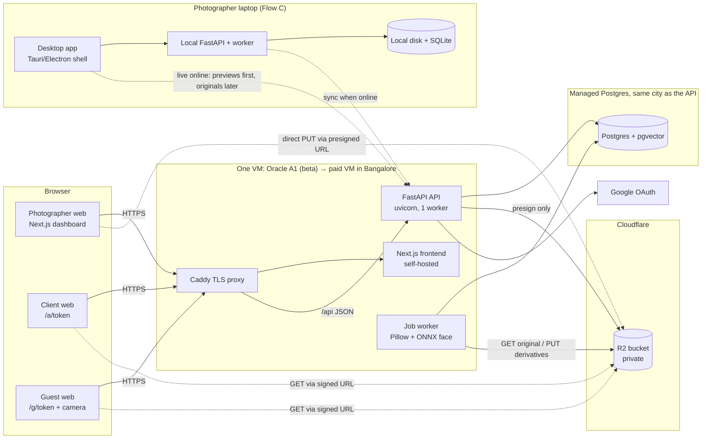
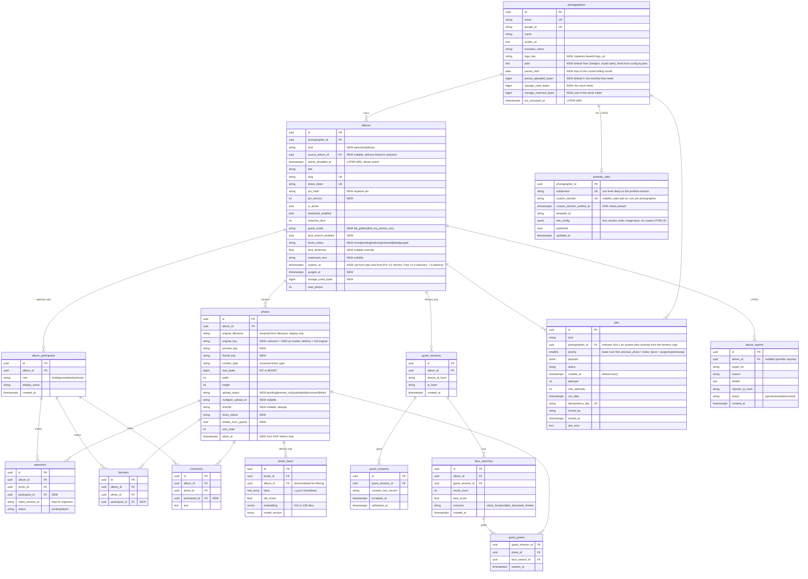
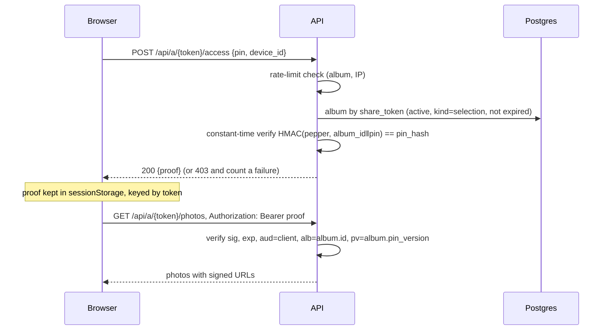
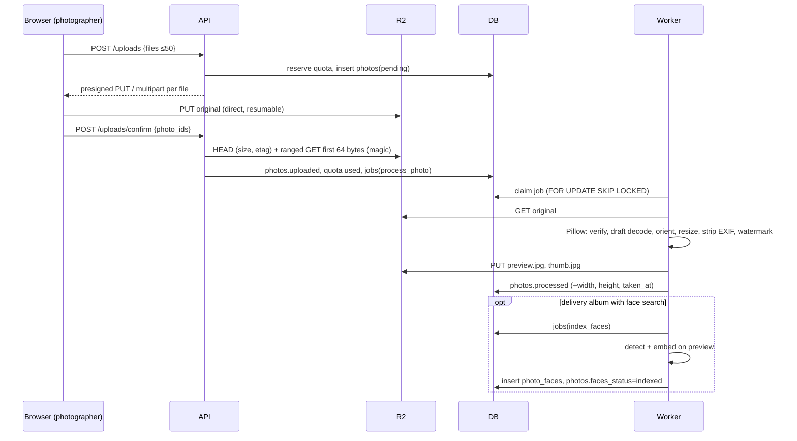
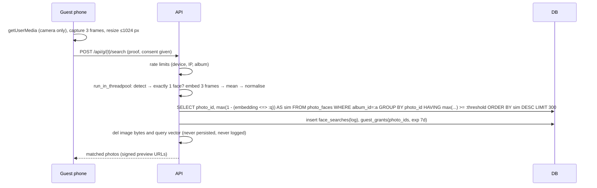
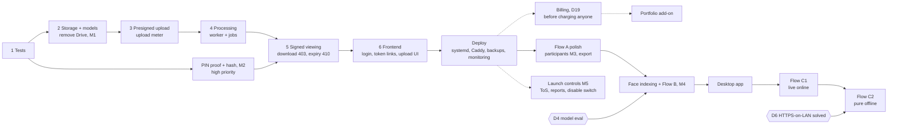

# Glimps: system design

Status: draft v2.1, 15 Nov 2026 (v2.1: database provider settled; D3, D7, D8, D13 and the custom domain decided; "decide by" points added in §15; job fairness rule added in §7.2.1; D24 decided; PROPOSED plans, monthly upload meter, portfolio and launch abuse controls added; portfolio hosting ladder and R2 as final storage). Docs only; nothing here is built unless §0 says so. v2 records the owner's decisions on retention, resolution, plan limits, storage, database, hosting, pricing, live sharing and deployment (§15 "Decided") and recomputes §9.
Conventions: **ASSUMPTION** = a guess to be checked. **UNVERIFIED** = a number I could not confirm from a primary source. Product choices that need the owner are in §15, each with a recommended default. `CLAUDE.md` holds the rules; this file holds the reasoning.

---

## Contents

0. [Current state, read from the code](#0-current-state-read-from-the-code)
1. [Goals, non-goals, users, flows](#1-goals-non-goals-users-flows)
2. [Component architecture](#2-component-architecture)
3. [Data model](#3-data-model)
4. [API surface](#4-api-surface)
5. [Access-control matrix](#5-access-control-matrix)
6. [Storage design](#6-storage-design)
7. [Processing pipeline and job system](#7-processing-pipeline-and-job-system)
8. [Face recognition](#8-face-recognition)
9. [Resource and cost model](#9-resource-and-cost-model)
10. [Security and privacy threat model](#10-security-and-privacy-threat-model)
11. [Environments and deployment](#11-environments-and-deployment)
12. [Desktop and offline architecture](#12-desktop-and-offline-architecture)
13. [Failure modes and scaling limits](#13-failure-modes-and-scaling-limits)
14. [Roadmap and dependencies](#14-roadmap-and-dependencies)
15. [Open decisions](#15-open-decisions)
16. [Sources](#16-sources)

---

## 0. Current state, read from the code

I read the models, the three applied migrations, the services and the routes. These are the places where the code differs from the brief or from the earlier docs:

| # | Finding | Where | Matters for |
|---|---|---|---|
| C1 | `add_comment` does **not** check that `photo_id` belongs to the album in the URL (select and favourite do). Anyone with one album's link can comment on any photo UUID they know | `album_service.add_comment` | Phase 1 test, fix with the PIN work |
| C2 | `get_photo_comments` filters by `photo_id` only, not album, so one album's token can read another album's comments. `delete_comment` is also not album-scoped | `album_service` | same |
| C3 | Migration `cae0715edc0e` (autogenerated) **dropped** `ix_photos_album_id`, `ix_selections_album_id`, `ix_comments_album_id`, `ix_comments_photo_id` and `ix_favorites_album_id`, because the models don't declare them. Every per-album query is now a sequential scan | migration `cae0715edc0e` | phase 2 migration must re-add them **and** declare them in the models so autogenerate stops dropping them |
| C4 | FK cascades exist only in the ORM (`cascade="all, delete-orphan"`). The DB FKs have no `ON DELETE CASCADE`, so deleting an album loads every child row into Python | models + migration 001 | phase 2 migration |
| C5 | The PIN is stored in plain text as `String(6)` and compared with `!=` (not constant-time) | `Album.pin`, `verify_album_pin` | PIN work |
| C6 | `PhotoResponse.full_url` (the Drive `webContentLink`) is returned to clients whatever `download_enabled` says, so the toggle is not enforced | `schemas.PhotoResponse` | phase 5; the column goes away in phase 2 |
| C7 | The selection-limit check is check-then-write, so two concurrent "yes" taps can exceed the limit | `albums.set_photo_selection` | phase 1 test; fix with a conditional insert or a row lock |
| C8 | `client_session` is a bare query parameter. Anyone holding the link and another device's session UUID can read or write that device's picks. Low risk (random UUIDv4), but unauthenticated | public routes | solved by binding the session into the access proof (§4.4) |
| C9 | Drive leftovers are still in the DB schema. `photographers.google_access_token` and `google_refresh_token` are always NULL now. `albums.gdrive_folder_id` and `gdrive_folder_url` are **NOT NULL**, so they block non-Drive albums. `photos.gdrive_file_id` (NOT NULL), `thumbnail_url` and `full_url` remain. `albums.py` still reads `photographer.google_access_token` | models, migrations | phase 2 |
| C10 | `share_token` has only a Python-side default (the model) and an explicit value in `create_album`; there is no server default. That is fine, but any raw SQL insert would fail | model | none |
| C11 | Comments are visible to every client session of the album: bride and groom see each other's comments | `get_photo_comments` | product decision D1 |
| C12 | The DB driver is psycopg 3, picked implicitly from `postgresql://` (see CLAUDE.md) | `.env` | phase 2 |

What matches the brief: share_token-only public lookup, the `is_active` filter, upserts with unique constraints for selection and favourite, the photo-belongs-to-album check for select and favourite, `PublicAlbumResponse` hiding Drive fields, the token and PIN, and the in-memory PIN rate limiter.

---

## 1. Goals, non-goals, users, flows

### Goals
- **G1:** Fast, simple online proofing. The couple marks Yes / Maybe / No, favourites and comments, and the photographer gets a clean list.
- **G2:** Guest delivery. Guests find and download only their own photos with a selfie, behind a link and PIN.
- **G3:** Live sharing during the event: first **live online** (hosted, venue internet required), later **pure offline** on a laptop.
- **G4:** The photographer controls access. Downloads, expiry, hidden photos and face-data purge are all enforced on the server.
- **G5:** Run on a very small budget: one rented VM (Oracle Always Free for the private beta, then a ~$24 VM in Bangalore), R2 with free egress, a ~$15 managed Postgres with pgvector. Hosted albums expire automatically (Pro 3.5 months; Free 14 / 7 days, proposed), then a 7-day grace.
- **G6:** Treat biometric data with DPDP-grade care from day one.

### Non-goals
- No CRM (leads, invoices, contracts, scheduling).
- No RAW support in v1.
- No liveness detection or anti-spoofing. Face search is a convenience filter, not a security control.
- No photo editing.
- No native iOS or Android apps (an Android guest app only if Flow C needs it; §12).
- No "unlimited" storage.

### Users
| User | Count per event | Identity | Rights |
|---|---|---|---|
| Photographer | 1 (plus 2-4 second shooters in Flow C, who use the same account) | Google login | everything on their albums |
| Client | 2 (bride and groom) plus a few family members | anonymous device session + chosen participant ("Bride / Groom / Family") | write on a **selection** album |
| Guest | 50-1000 (**ASSUMPTION**, typical ~300) | anonymous device session | read-only on a **delivery** album, filtered by face |

### Plans (PROPOSED, 15 Nov 2026; pricing still to be validated with photographers)

These replace the earlier per-event limits and the 1-event trial.

| | **Free** (permanent, not a time trial) | **Pro** (₹600 / $6 per month) | **Studio** (later, per seat) |
|---|---|---|---|
| Uploads (the monthly meter, §6.4) | 10 GB / billing month | 50 GB / month, pooled across all albums (~5 events) | pooled GB across seats |
| Stored-bytes ceiling (safety net) | 20 GB (ASSUMPTION) | 200 GB (ASSUMPTION) | – |
| Desktop app (uploader, local compression, selection and favourites download, XMP export) | ✔ | ✔ | ✔ |
| Selection albums | kept **14 days** | kept **3.5 months** | – |
| Delivery albums | kept **7 days**, **full-gallery browsing only** (`guest_mode` forced to `full_gallery`) | kept 3.5 months, both guest modes | – |
| Face search | – | ✔ | ✔ |
| Live online mode (C1) / offline mode (C2) | – / – | ✔ / ✔ | ✔ |
| Own branding | – ("Made with Glimps" mark on public pages) | ✔ | shared branding |
| Portfolio website | – | basic template site on a free subdomain included (PROPOSED, built after the core product, §6.5) | – |
| Add-ons | – | portfolio customisation (extra templates, custom domain); extra upload blocks of 10 GB / month; longer retention (later) | – |
| Accounts | one account per Google login | | roles; needs a workspace layer (§3.3) |

- **Enforcement is server-side.** The plan is read from `photographers.plan`, and the limits come from config keyed by plan name. Pro-only features (face search, live online, branding, portfolio, `find_my_photos_only`) are refused for Free by the API, not just hidden in the UI. Offline mode runs on the laptop, so the desktop app checks the plan through the API when it's online (ASSUMPTION: offline mode stays unlocked for a period after the last successful check, length to be set in the desktop phase).
- **"One account per Google login"** stops casual duplicates, not determined abuse, since anyone can create more Google accounts. The abuse controls in §10 are the real backstop.
- **Earlier decisions this supersedes:** the per-event caps (old D9, D17), the 1-event / 2 GB trial, and "3.5 months for all hosted albums", which is now Pro only. Decided item 7 (pricing) is now PROPOSED until it's validated with photographers.

### The flows

Flow C (live sharing) has two modes. **C1 live online is built before C2 pure offline.**

| | Flow A: Selection | Flow B: Guest delivery | Flow C1: Live online | Flow C2: Pure offline |
|---|---|---|---|---|
| When | after the event | after the event | during the event | during the event |
| Network | online | online | internet at the venue (guests on mobile data or venue WiFi) | LAN only, no internet |
| Who | client (few, named, write) | guests (many, anonymous, read) | guests | guests |
| Album kind | `selection` | `delivery` | `delivery` (filled live by the desktop app) | local album (syncs to `delivery`) |
| Face search | no | yes (camera only) | yes, in the cloud over HTTPS | yes, on the laptop |
| Storage | R2 | R2 | R2: previews first, originals later | laptop disk (LocalStorage) |
| Routes | `/api/a/{share_token}` | `/api/g/{delivery_token}` | same as Flow B | local `/api/g/...` on the laptop |
| Blocker | – | face model eval (D4) | desktop app | HTTPS on the LAN (D6), unsolved |

---

## 2. Component architecture



| Component | Responsibility | Tech | Runs on | Talks to |
|---|---|---|---|---|
| Web frontend | Photographer dashboard, client selection UI, guest delivery UI, upload UI (direct to storage), camera capture | Next.js 16, React 19, Tailwind, Zustand | the same VM as the API, `next start` behind Caddy (D11 decided: no Vercel) | API (JSON); R2 (signed GET and PUT only) |
| API server | Auth, albums, access proofs, presigning, plan limits, selection writes, face search (synchronous, small), enqueueing jobs | FastAPI, SQLAlchemy async, psycopg 3 | the VM, behind Caddy | Postgres, R2 (presign plus HEAD), Google (login only), Razorpay (webhooks, once billing is built) |
| Job worker | Image derivatives, EXIF stripping, watermark, face indexing, purges, quota reconciliation | Python process (`python -m app.worker`), Pillow, onnxruntime, boto3 | same VM, separate systemd unit | Postgres (job table), R2 |
| Postgres | System of record: albums, photos (keys, not URLs), selections, face embeddings, jobs, logs | plain Postgres + pgvector, no provider-specific features, so switching is a dump and restore. Today: Supabase (session pooler, port 5432). Target (decided): DigitalOcean Managed PostgreSQL, Bangalore; beta topology is D18 | managed provider, **same city as the API** | – |
| Object storage | Originals, masters, previews, thumbnails, logos, portfolio images | **Cloudflare R2 (final choice)**, S3 API, private bucket. `StorageBackend` stays provider-agnostic; Backblaze B2 is only revisited past roughly **1 TB stored**, after a download-speed test from Mumbai | Cloudflare | – |
| Local storage backend | Same interface as R2, backed by the filesystem; used in dev and in Flow C | Python class; files under `MEDIA_ROOT`; HMAC-signed URLs served by FastAPI | dev machine / laptop | – |
| Desktop app | Folder-watch upload, selection download, XMP export, Flow C1 live upload (previews first), Flow C2 local server | Tauri (D10) wrapping the web UI plus a bundled Python sidecar running the same FastAPI app with `MODE=local` | photographer laptop | local API; cloud API when online |
| Local mode | Flow C: guest gallery and face search over WiFi with no internet | same FastAPI code, SQLite (or bundled Postgres; D12), LocalStorage, local vector search | laptop | phones on the LAN |

Design principle: **one codebase, two modes** (`MODE=cloud | local`). Storage, DB URL and auth differ by configuration; routes and services are shared.

---

## 3. Data model

### 3.1 ER diagram (target)



### 3.2 Changes and their migrations

The applied migrations (`001`, `002`, `cae0715edc0e`) are never edited. Every change below is a **new** autogenerated migration. `upgrade()` is shown to the owner before it is applied.

| Migration (phase) | Content |
|---|---|
| **M1: storage and Drive removal (phase 2)** | Drop `photographers.google_access_token` and `google_refresh_token`. Drop `albums.gdrive_folder_id` and `gdrive_folder_url`. Drop `photos.gdrive_file_id`, `thumbnail_url` and `full_url`. Add `photos.original_key`, `preview_key`, `thumb_key`, `upload_status`, `multipart_upload_id`, `sha256` and `taken_at`; `size_bytes` becomes BIGINT. Add `albums.kind` (default `selection`), `expires_at`, `storage_used_bytes` and `purged_at`. Add `photographers.plan` (text, default `'free'`), `period_start` (date), `period_uploaded_bytes` (bigint, default 0), `storage_used_bytes`, `storage_reserved_bytes` (the stock meter) and `logo_key`. **No `storage_quota_bytes` column and no fixed 5 GB default:** limits come from config keyed by plan name (§6.4). Re-add the album_id indexes dropped in C3 and **declare them in the models**. Recreate FKs with `ON DELETE CASCADE` (C4). Create the `jobs` table **with the fairness columns** (§7.2.1): `photographer_id` (FK → photographers, NULL for system jobs, `ON DELETE CASCADE`), `priority` (smallint, NOT NULL), `created_at` (timestamptz, NOT NULL, default `now()`), plus indexes `(status, priority, run_after)` and `(photographer_id, status)`, all declared in the model so autogenerate keeps them. Leave room now (columns may be NULL until used): `albums.guest_mode`, `faces_status`, `face_search_enabled`, `source_album_id`, `watermark_text`; `photos.faces_status`, `hidden_from_guests`. |
| **M2: PIN hardening (PIN work)** | Add `albums.pin_hash` and `pin_version` (default 1). Data migration: hash existing PINs, then drop `pin`. |
| **M3: participants (Flow A polish)** | Create `album_participants`. Add nullable `participant_id` to selections, favourites and comments. Backfill one participant per existing `client_session_id`. New unique constraint `(photo_id, participant_id)`; the old one is dropped in a later migration. |
| **M4: faces and guests (Flow B)** | `CREATE EXTENSION vector`. Create `photo_faces`, `guest_sessions`, `guest_consents`, `face_searches` and `guest_grants`. Index `photo_faces(album_id)` (btree). No ANN index at first (§8.4). |
| **M5: launch controls and portfolio (before public launch)** | `photographers.tos_accepted_at` and `tos_version`; `albums.admin_disabled_at`; `abuse_reports`; `portfolio_sites` (when the portfolio add-on is built). Billing tables (subscription state, add-on blocks) come with the Billing phase (D19) |

Data that must **not** live in Postgres: image bytes, selfies (never stored anywhere), presigned URLs, tokens.

### 3.3 Studio and workspaces (later)

Studio (per seat, pooled GB, shared branding, roles) needs a **workspace** layer:
- a `workspaces` table and `workspace_members` (role);
- `workspace_id` on the owning rows;
- meters and limits moved from the photographer to the workspace.

It is added later with a **backfill of one workspace per photographer**, so existing accounts become one-seat workspaces.

To keep that migration small, phases 2-6 route every ownership check through one helper (e.g. `get_owned_album`) rather than comparing `photographer_id` inline (ASSUMPTION on approach). The job fairness key (§7.2.1) may then move from photographer to workspace.

---

## 4. API surface

Base: `https://api.<domain>`. Every public route resolves the album **by token only**. A slug never resolves a public route; a slug in a token position returns 404.

### 4.1 Photographer (auth: `access_token` httpOnly cookie, JWT signed with `JWT_SECRET_KEY`)

| Route | Purpose | Rate limit (ASSUMPTION) |
|---|---|---|
| `GET /api/auth/google/login` · `GET /api/auth/google/callback` · `POST /api/auth/logout` | login (exists) | 20/min/IP |
| `GET /api/photographer/me` · `PATCH /api/photographer/branding` | profile (exists) | 60/min |
| `POST /api/photographer/logo/upload-url` · `POST /api/photographer/logo/confirm` | logo as an R2 object (replaces base64) | 10/min |
| `POST /api/albums` `{kind, title, pin?, download_enabled, selection_limit?, guest_mode?}` | create (no Drive URL). Sanity cap: at most 20 albums per billing month (ASSUMPTION). `expires_at` is set by the server from plan and kind (§1 Plans). Free: `guest_mode` forced to `full_gallery`, `face_search_enabled=false` | 30/min |
| `GET /api/albums` · `GET/PATCH/DELETE /api/albums/{id}` | CRUD (DELETE enqueues `purge_album`) | 60/min |
| `POST /api/albums/{id}/uploads` `{files:[{name,size,content_type}] ≤50}` | validate type and size (≤ 30 MB per file), and check the monthly upload meter and the stored-bytes ceiling (§6.4); over the limit, the response is an error with code `upload_limit_reached` and upgrade options; otherwise reserve bytes; create `photos` rows (`pending`); return a presigned PUT, or a multipart init for files ≥ 16 MB | 20/min |
| `POST /api/albums/{id}/uploads/{photo_id}/parts` `{part_numbers}` · `/complete` `{parts}` · `/abort` | multipart signing | 120/min |
| `POST /api/albums/{id}/uploads/confirm` `{photo_ids}` | HEAD each object, check size and magic bytes, move reservation to used, set `uploaded`, enqueue `process_photo` | 20/min |
| `GET /api/albums/{id}/photos?page` | photos with signed thumb URLs and statuses | 120/min |
| `PATCH /api/albums/{id}/photos/{pid}` `{hidden_from_guests, sort_order}` · `DELETE …/{pid}` | manage | 120/min |
| `GET /api/albums/{id}/selections` · `/selections/detail` · `/comments` · `/participants` | review (exists, plus participants) | 60/min |
| `GET /api/albums/{id}/export?format=csv\|txt\|xmp-zip` | filename export / XMP pack | 10/min |
| `POST /api/albums/{id}/delivery` | create a delivery album **linked** to a selection album (same event, own token, own PIN, own uploads of full originals). Photos are never copied between the two: the selection album holds only masters | 10/min |
| `POST /api/albums/{id}/faces/index` · `DELETE /api/albums/{id}/faces` · `GET /api/albums/{id}/face-searches` | face indexing, purge, search log | 10/min |
| `GET /api/albums/{id}/jobs` | processing progress | 60/min |
| `GET /api/photographer/usage` | plan, the month's uploaded bytes vs limit, stored bytes vs ceiling, albums this month, period end | 60/min |
| `GET/PUT /api/portfolio` · `POST /api/portfolio/images/upload-url` · `/confirm` · `DELETE /api/portfolio/images/{key}` · `PUT/DELETE /api/portfolio/custom-domain` | portfolio site config, images and custom domain (§6.5) | 30/min |
| `GET /internal/tls/allow?domain=` (localhost only, not routed publicly) | Caddy on-demand TLS approval: stored + DNS-verified custom domains only, with our own throttle (§6.5) | N approvals/hour |
| `POST /api/admin/albums/{id}/disable` · `/enable` · `GET /api/admin/reports` | abuse switch and report queue (admin allow-list, §7.2.2 ASSUMPTION) | – |
| `POST /api/report` `{target_url, reason, details}` (public, no auth) | "Report this page" link on every public page | 5/hour/IP |
| `GET /api/sites/{subdomain}` (public) | portfolio config and image URLs for the Next.js site route | 120/min/IP |
| `PUT/GET /api/local-storage/{key}?exp&sig` (only when `STORAGE_BACKEND=local`) | dev/offline stand-in for R2 signed URLs | – |

### 4.2 Client: selection album (auth: share token in the path, plus an access proof)

Prefix `/api/a/{share_token}`. Every route except `GET /` and `POST /access` requires the proof.

| Route | Purpose | Rate limit |
|---|---|---|
| `GET /` | title, branding, `requires_pin`, `expires_at`; returns 410 if expired, 404 if inactive or wrong kind | 60/min/IP |
| `POST /access` `{pin?, device_id}` | checks the PIN (rate-limited and locked out) and returns the proof | 5 failures / 15 min / (album, IP) → 429 |
| `POST /participant` `{role, display_name}` → new proof including `pid` | "Who's choosing?" | 10/min |
| `GET /photos?page` | thumb and preview signed URLs (10 min) | 120/min |
| `GET /photos/{pid}/original` | 302 to a signed URL with `Content-Disposition: attachment`; **403 if `download_enabled=false`** | 60/min |
| `POST /select` · `GET /selections` | yes/maybe/no/clear (participant from the proof, not the query) | 300/min |
| `POST /favorite` · `GET /favorites` | | 300/min |
| `POST /comment` · `GET /photos/{pid}/comments` · `DELETE /comment/{cid}` | album-scoped (fixes C1/C2) | 60/min |

### 4.3 Guest: delivery album (auth: delivery token in the path, plus a guest proof)

Prefix `/api/g/{delivery_token}`. These are separate routers and dependencies; no client route accepts a guest proof and vice versa (the proof carries `aud`).

| Route | Purpose | Rate limit |
|---|---|---|
| `GET /` | branding, `requires_pin`, `guest_mode`, `consent_text_version`, `face_search_enabled`; returns 410 if expired | 60/min/IP |
| `POST /access` `{pin?, device_id}` | guest proof; creates a `guest_sessions` row | same lockout as clients |
| `POST /consent` `{consent_text_version}` | records consent; search is refused without it | 10/min |
| `POST /search` (multipart, one JPEG ≤ 2 MB, captured client-side) | embed, compare, write grants, log, **discard the selfie**; returns matched photos with signed URLs | **3/hour/device, 10/hour/IP, 500/day/album** |
| `GET /photos?page` | **only if `guest_mode=full_gallery`**, otherwise 403 | 120/min |
| `GET /my-photos` | photos granted to this guest session (re-sign URLs without searching again) | 60/min |
| `GET /photos/{pid}/download` | requires `download_enabled`; in `find_my_photos_only` mode also requires a live `guest_grants` row | 60/min |
| `DELETE /me` | guest withdraws consent; deletes their grants and session | 5/min |

### 4.4 How the access proof works



- **Format:** compact JWT (HS256) signed with a **separate** `ACCESS_PROOF_SECRET`, not the photographer key. Claims: `aud` (`client` or `guest`), `alb` (album id), `pv` (pin_version), `sid` (device id), `pid` (participant id, clients only), `gsid` (guest session id, guests only), `exp` (12 h, ASSUMPTION).
- **Always required**, even on albums without a PIN. `/access` then just checks active, expiry and kind. This keeps one code path and lets us revoke access.
- **Revocation:** changing or removing the PIN, deactivating the album, or the photographer pressing "revoke links" bumps `pin_version`, which invalidates every outstanding proof.
- **Header, not cookie (decided, D13).** It works across the `app.` and `api.` hosts with no cookie problems, works in in-app browsers, and is scoped to one album. The cost is exposure to XSS within that album's scope, which is mitigated by a strict CSP and a short lifetime.
- **PIN storage:** `HMAC-SHA256(PIN_PEPPER, album_id ‖ pin)`. A 4-6 digit PIN has only 10⁴-10⁶ possibilities, so a plain or salted hash adds little against offline brute force. Real protection comes from the server-side **pepper** (kept outside the DB) plus online rate limiting.

---

## 5. Access-control matrix

`P` = owning photographer, `C` = client proof for this selection album, `G` = guest proof for this delivery album, `—` = denied.

| Resource / action | P | C | G | Server-side enforcement |
|---|---|---|---|---|
| Album create/update/delete | ✔ | — | — | `get_current_photographer` and `album.photographer_id == me`, else 404 (not 403, so existence isn't revealed) |
| Album public info | ✔ | ✔ | ✔ | resolved by token; checks `is_active`, `admin_disabled_at` (once M5 exists), `kind` matches the router, `expires_at` (410) |
| Pro-only features (face search, live online, branding, portfolio, `find_my_photos_only`) | Pro only | – | – | `photographers.plan` checked server-side on every write that enables them, and at search time for the album owner's plan |
| Upload / confirm / delete photo | ✔ | — | — | owner check; monthly meter and stock ceiling in one conditional `UPDATE` (§6.4); albums-per-month cap at creation |
| List photos (thumb/preview URLs) | ✔ | ✔ | full_gallery only | `require_proof(aud)`; for guests `album.guest_mode == full_gallery`, else 403. Hidden photos are excluded for guests |
| Download original | ✔ | if download_enabled | if download_enabled **and** (full_gallery or a grant exists) | the endpoint checks the flag **before** signing; the original key is never returned in any response |
| Selection / favourite / comment write | — | ✔ | — | proof `aud=client` and a `pid` present; `photo.album_id == album.id` in the same query; selection limit via a conditional insert |
| Read selections / comments | all | own participant (comments: D1) | — | filtered by `pid` from the proof, never from a query parameter |
| Face index / purge / search log | ✔ | — | — | owner check |
| Face search | — | — | ✔ | proof `aud=guest`, consent row exists, rate limits, `face_search_enabled`, `faces_status == indexed` |
| Guest withdraw | — | — | own | `gsid` from the proof |
| Branding / logo | ✔ | read | read | owner check; public reads go through the album payload |

---

## 6. Storage design

### 6.1 Key layout (server-generated, never from client filenames)

```
albums/{album_id}/{photo_id}/original.{jpg|png|webp}   private; selection: ~2560 px master, delivery: full original
albums/{album_id}/{photo_id}/preview.jpg               ≤1600 px, q82, EXIF/GPS stripped, optional watermark
albums/{album_id}/{photo_id}/thumb.jpg                 ≤400 px, q75, stripped
branding/{photographer_id}/logo-{uuid}.{png|webp|svg}  public-read via signed URL (long TTL)
portfolio/{photographer_id}/{uuid}.jpg                 portfolio images, resized on upload; NOT touched by the expiry purge
templates/{template_id}/{name}.jpg                     template sample images (royalty-free or owned; licence recorded, §6.5)
```

The extension comes from the **detected** content type (magic bytes), not the filename. The original filename is kept in the DB for display and export only.

### 6.2 Signed URL lifetimes

| Use | TTL | Notes |
|---|---|---|
| Upload PUT / multipart part | 15 min | bound to the exact key and content type; size checked at confirm |
| Thumb / preview GET | 10 min | the frontend re-fetches the list (re-signs) when URLs expire; signatures are stable within a 5-minute bucket so the browser cache still hits (ASSUMPTION: implement by rounding `exp`) |
| Original download | 5 min | `ResponseContentDisposition=attachment; filename="<original name>"` |
| Logo | 24 h | low sensitivity |

### 6.3 What lives where

| Data | R2 (cloud) | Postgres | Laptop disk (Flow C) |
|---|---|---|---|
| Image bytes | ✔ | — | ✔ |
| Object keys, sizes, statuses | — | ✔ | SQLite |
| Face embeddings | — | ✔ (pgvector) | local index |
| Selfies | **never** | **never** | **never** (memory only) |
| Search log, consents | — | ✔ | SQLite, synced |

### 6.4 Lifecycle

- **Limits meter (PROPOSED with the plans in §1; replaces the per-event limits).** Two meters per photographer, with limits from config keyed by plan name:
  - **Flow meter:** `period_uploaded_bytes`, the bytes uploaded in the current billing month (Free 10 GB, Pro 50 GB plus any 10 GB add-on blocks). It resets when `period_start` rolls over: on the subscription's billing anchor for Pro, and on the signup day of the month for Free (ASSUMPTION). **Deleting photos does not refund the month's meter.**
  - **Stock meter:** `storage_used_bytes + storage_reserved_bytes`, the total stored bytes, capped at a safety-net ceiling (Free 20 GB, Pro 200 GB; ASSUMPTION). Pro at the full 50 GB a month with 3.5-month retention settles near 190 GB, so the ceiling is rarely the binding limit. Deletions and expiry purges free stock.
  - **Check:** at `upload-url` time, in one conditional statement: `UPDATE photographers SET period_uploaded_bytes = period_uploaded_bytes + :n, storage_reserved_bytes = storage_reserved_bytes + :n WHERE id = :me AND period_uploaded_bytes + :n <= :month_limit AND storage_used_bytes + storage_reserved_bytes + :n <= :stock_ceiling`. Zero rows updated means over the limit.
  - **Over the limit:** new upload URLs are refused with a clear message and upgrade options (code `upload_limit_reached`). Existing albums, viewing, selections, downloads and processing keep working.
  - **Sanity caps:** 30 MB per file; at most 20 albums created per billing month (ASSUMPTION).
  - **Reservations that never complete** (abandoned or failed uploads) are released from both meters by the sweeper, because those bytes were never stored. ASSUMPTION; only deletion of stored photos is non-refundable.
- **Meter accounting.** Reserve at `upload-url` time using the declared size. At `confirm`, reconcile with the size from a HEAD request. A sweeper job releases reservations for `pending` photos older than 24 h and aborts dangling multipart uploads. The R2 bucket lifecycle rule also aborts incomplete multipart uploads after 1 day.
- **Expiry.** Pro albums live **3.5 months** (planning figure). Free selection albums live **14 days** and Free delivery albums **7 days** (proposed). `expires_at` is set by the server from plan and kind at creation. Changing plan later doesn't move existing albums' dates (ASSUMPTION, D25). Once `expires_at` passes, public routes return 410. A daily `expire_albums` job marks albums expired; after a **7-day grace** `purge_album` deletes the face rows, then the objects, then sets `purged_at` and releases the bytes. A reminder email before expiry is optional (D21). What the photographer can do during the grace is D23.
- **Purge order.** Delete the DB face rows first (biometric data goes first), then the R2 objects in batches (one DeleteObjects call per 1000 keys), then the photo rows. The job is idempotent: deleting a missing object is a no-op.
- **Resolution (decided, D5).** Selection albums store ~2560 px masters (resized in the browser or the desktop app before upload) plus preview and thumbnail. Delivery albums store full-quality originals. A photo is stored once and never duplicated between the two album kinds; a delivery album gets its own uploads.

### 6.5 Portfolio website (PROPOSED; built after the core product)

**Packaging (PROPOSED).**
- **Pro includes** a basic template portfolio site on a free subdomain.
- **Paid add-on:** more customisation, meaning extra templates and a custom domain.
- **Timing:** built after the core product (phases 1-6, Deploy, Billing and the Flow A/B work). It's **not announced or marketed before it exists.**

**Content.**
- **Templates.** A few templates ship with the frontend code.
  - **One** Next.js route renders any photographer's site from their `portfolio_sites.site_config`: template id, text, section order and image keys.
  - There's no per-site build and no custom HTML or JS. Text is rendered escaped.
- **Sample images** live under `templates/{template_id}/` and must be royalty-free or owned. Record each image's source, author and licence in a manifest committed with the templates (e.g. `templates/LICENCES.md`). No image ships without an entry.
- **Photographer images** live under `portfolio/{photographer_id}/`:
  - at most **30 images, 2 MB each**;
  - uploaded with the same presigned flow, then resized by the worker (e.g. ≤ 2400 px long edge, EXIF stripped; ASSUMPTION on size);
  - **excluded from the album expiry purge** (that only deletes `albums/{album_id}/…`);
  - deleted when Pro or the add-on lapses (after a grace, ASSUMPTION) or the account is deleted;
  - counted against the stock ceiling, not the monthly upload meter (ASSUMPTION).
  - Images are served from R2 via signed or public-read URLs in every hosting mode below.

**Hosting ladder.**

| Step | What | How | Cost |
|---|---|---|---|
| **1. v1: free subdomain** (included in Pro) | `name.<portfolio-domain>` on a **separate portfolio domain** (not the `app.`/`api.` domain) | the portfolio domain's DNS on Cloudflare; **one proxied wildcard record** `*` → the VM. Cloudflare's free **Universal SSL covers the apex and first-level subdomains only** [S29], so names are exactly one level deep (`name.<portfolio-domain>`), **never** `name.sub.<portfolio-domain>`. Cloudflare → origin uses a Cloudflare Origin CA wildcard certificate on Caddy (SSL mode Full (strict); ASSUMPTION on setup). Next.js middleware maps the `Host` header to the site route. Names are validated (`[a-z0-9-]{3,30}`, no leading or trailing hyphen) against a reserved-word list (`www`, `api`, `app`, `admin`, `mail`, …) | a second domain (~$1 / month, UNVERIFIED); Cloudflare Free $0 |
| **2. Later: custom domain** (paid add-on) | the photographer's own domain, e.g. `janephotos.in` or `www.janephotos.in` | **Caddy on-demand TLS on the VM** (details below). The photographer points an **A record** at our reserved IP (apex) or a **CNAME** at a fixed target such as `domains.<portfolio-domain>` (subdomains). Apex via an A record is **expected to work but UNVERIFIED until tested on one real domain** | Let's Encrypt $0; reserved IP $0 while attached on DigitalOcean [S30] |
| **3. Interim, before step 2 exists** | the photographer's domain forwards to their subdomain | **registrar URL forwarding** (301) from their domain to `name.<portfolio-domain>`; we only document it in a help page | $0 to us |
| Fallback option (not planned) | custom domains via **Cloudflare for SaaS** | 100 custom hostnames included, then **$0.10 per hostname per month** [S28]; **no apex proxying and no wildcard custom hostnames below Enterprise** [S31], so `janephotos.in` (apex) would not work on our plan | per hostname |

**Step 2 in detail (Caddy on-demand TLS).**
- **Approval endpoint.** Caddy asks our API before issuing any certificate. The endpoint approves only a domain that:
  - is stored in `portfolio_sites.custom_domain` (unique; **one custom domain per photographer**);
  - belongs to an active Pro + add-on account;
  - passes a **DNS check** (its A/AAAA records, or CNAME target, resolve to our reserved IP / target). The result is recorded in `custom_domain_verified_at`.
  - Everything else gets a 4xx, so random hostnames pointed at our IP can't make Caddy issue certificates.
- **Not public.** Caddy's docs now recommend a **permission module** over a public `ask` URL [S32]. The endpoint listens on `localhost` only (or a unix socket) and is not routed through the public API (ASSUMPTION on exact wiring).
- **Throttling has to be ours.** Caddy's own on-demand rate limit (`interval`/`burst`) was **deprecated and has been removed** [S32], so the "Caddy issuance throttling" in the brief has to be implemented outside Caddy:
  - the approval endpoint allows at most N new approvals per hour (ASSUMPTION N = 10);
  - only verified domains are ever approved;
  - Let's Encrypt's own per-domain and per-account limits are the outer bound.
- **Reserved static IP.**
  - **DigitalOcean:** reserved IPs are **free while assigned to a Droplet**, $5 / month if left unassigned [S30].
  - **Oracle Always Free:** reportedly allows one reserved public IP per tenancy (community reports only; **UNVERIFIED**, check the tenancy's `reserved-public-ip-count` limit).
  - The IP must survive a VM rebuild, since photographers' DNS points at it. That's why custom domains wait for the paid VM.
- **Monitoring.** Alert on certificate issuance or renewal errors in Caddy's logs. Run a daily check that every approved custom domain still resolves to us and serves a valid certificate expiring in more than 14 days (ASSUMPTION). If a domain stops resolving to us, mark it unverified and stop approving it.
- **Trade-off.** Custom domains **bypass Cloudflare**: no CDN and no DDoS shield for the site's HTML, which comes straight from the VM. Images still come from R2. A traffic spike or attack on one custom domain hits the same VM as the API. Mitigations are Caddy request limits and caching of the rendered pages (ASSUMPTION).

**Security note.** Portfolios live on their own registrable domain, so a portfolio page can never set or read cookies for `app.`/`api.`. Content stays template-rendered with no user HTML or JS.

---

## 7. Processing pipeline and job system



### 7.1 States

- `photos.upload_status`: `pending` → `uploaded` → `processed`, or `failed` with a reason. A photo that is `uploaded` but not yet processed shows a placeholder.
- Flow C1 (live online) adds `pending` → `preview_only` → `processed`-for-viewing: the desktop app uploads a preview and thumb first, guests can search and view, and the original arrives later (`uploaded`/`processed` again once it lands). Downloads of an original return 409 "not uploaded yet" until then. Whether the server trusts client-made previews is D22.
- `photos.faces_status` / `albums.faces_status`: `none` → `pending` → `indexing` → `indexed`, `failed` or `purged`.
- `jobs.status`: `queued` → `running` → `succeeded`, or `failed` (to be retried) → `dead` once `attempts == max_attempts`.

### 7.2 Decided: a Postgres-backed job table plus one dedicated worker process (D3)

FastAPI `BackgroundTasks` is **not enough**:
- jobs are lost on restart or deploy;
- they run inside the API process, so CPU-heavy Pillow and ONNX work blocks request handling on a 1-2 core VM;
- there are no retries, no visibility and no concurrency cap.

The current code already shows this: the Drive indexing failure was only visible in logs.

Celery or arq with Redis would work but adds a service and its memory to a small VM, for throughput we don't need yet. A `jobs` table in the Postgres we already have gives:
- durability and visibility (the photographer UI reads job progress from it);
- transactional enqueue (photo row and job committed together);
- `SELECT … FOR UPDATE SKIP LOCKED` for safe claiming.

The worker polls every 2 s. I'm not relying on LISTEN/NOTIFY, because it doesn't work reliably through transaction-mode poolers (DigitalOcean's built-in pool is PgBouncer); polling works everywhere. The off-the-shelf alternative is `procrastinate`, a Postgres-based Python task library; evaluate it before hand-rolling about 150 lines.

| Property | Design |
|---|---|
| Idempotency | `idempotency_key` unique (e.g. `process_photo:{photo_id}:v1`). Handlers write deterministic keys and overwrite, and a handler that finds the photo already `processed` with the same version exits early |
| Retries | exponential backoff 30 s → 2 min → 10 min → 1 h, `max_attempts=5`; permanent errors (corrupt image, decompression bomb) go straight to `dead` and mark the photo `failed` |
| Stuck jobs | `locked_at` older than 15 min returns the job to `queued` (worker crash) |
| Concurrency | `WORKER_CONCURRENCY` slots in total: 1 on the 2-vCPU paid VM (it shares the box with Next.js and the API) and up to 2 on the 2-OCPU / 12 GB A1 (see the single-slot caveat in §7.2.1); Pillow `MAX_IMAGE_PIXELS = 60_000_000`; one face-model session per process |
| Priority | `priority` smallint, lower runs first: `process_photo` (10) → `index_faces` (20) → `purge_album`, `purge_faces`, `expire_albums`, `sweep_reservations`, `reconcile_quota` (30). Values are ASSUMPTION; only the order is decided |
| Fairness | per-photographer running cap, work-conserving (§7.2.1) |
| Job kinds | `process_photo`, `index_faces`, `purge_album`, `purge_faces`, `expire_albums` (cron), `sweep_reservations` (cron), `reconcile_quota` (cron) |

The worker is a plain synchronous process. The "blocking work through `run_in_threadpool`" rule applies to the **API** (Google token exchange, the selfie embedding in `/search`, boto3 calls).

### 7.2.1 Fairness between photographers (decided)

**Rule.** No photographer may have more than `JOB_MAX_RUNNING_PER_PHOTOGRAPHER` (config, default **2**) jobs `running` at once. The cap is **work-conserving**: it applies only while at least one other photographer has queued jobs that are ready to run. If nobody else is waiting, the worker uses all its slots for the one photographer. System jobs (`expire_albums`, `sweep_reservations`, `reconcile_quota`) have `photographer_id` NULL and are exempt from the cap.

**Claim order:**
1. job kind priority (`priority` ascending); kind priority stays above fairness;
2. the photographer with the fewest `running` jobs;
3. the photographer whose most recent claim (`max(locked_at)` over their jobs) is oldest, **NULL first** (D24, decided);
4. the oldest `created_at`.

**Requirement:** `locked_at` is **not cleared** when a job finishes (succeeded, failed or dead), so `max(locked_at)` reflects the last claim. No new column is needed.

**Claim procedure:** two passes inside one transaction, serialised by a transaction-scoped advisory lock.

```sql
BEGIN;
-- serialise claims across all worker processes, so two workers can't both see "1 running" and exceed the cap
SELECT pg_advisory_xact_lock(hashtext('glimps.jobs.claim'));

-- pass 1: a ready job whose photographer is under the cap (or a system job)
WITH running AS (
  SELECT photographer_id, count(*) AS n
  FROM jobs WHERE status = 'running' AND photographer_id IS NOT NULL
  GROUP BY photographer_id
), last_claim AS (
  SELECT photographer_id, max(locked_at) AS last_locked_at
  FROM jobs WHERE photographer_id IS NOT NULL
  GROUP BY photographer_id
)
SELECT j.id
FROM jobs j
LEFT JOIN running r     ON r.photographer_id  = j.photographer_id
LEFT JOIN last_claim lc ON lc.photographer_id = j.photographer_id
WHERE j.status = 'queued' AND j.run_after <= now()
  AND (j.photographer_id IS NULL OR coalesce(r.n, 0) < :cap)
ORDER BY j.priority, coalesce(r.n, 0), lc.last_locked_at NULLS FIRST, j.created_at
LIMIT 1
FOR UPDATE OF j SKIP LOCKED;

-- pass 2 (only if pass 1 returned nothing): the same query without the cap condition.
-- Reaching it means every ready job belongs to a capped photographer, so going over the cap is work-conserving.

UPDATE jobs SET status = 'running', locked_by = :worker, locked_at = now(), attempts = attempts + 1
WHERE id = :claimed_id;
COMMIT;
```

- **Why an advisory lock as well as `SKIP LOCKED`:** `SKIP LOCKED` stops two workers taking the same row, but not two workers each taking a *different* row for the same photographer after both counted "1 running". The lock makes the count-and-claim atomic. It is held only for the claim (milliseconds), not while the job runs.
- **Pooler-safe:** `pg_advisory_xact_lock` is transaction-scoped, so it releases at `COMMIT`/`ROLLBACK` and works through a transaction-mode pooler (PgBouncer). Session-scoped advisory locks would not.
- **Indexes:** `(status, priority, run_after)` serves the queued scan; `(photographer_id, status)` serves the running counts. The `last_claim` aggregate scans each photographer's jobs. That's fine while finished jobs are pruned after 30 days; if it ever shows up in query plans, add an index on `(photographer_id, locked_at)` (still no new column).
- **Stuck jobs count against the cap.** A crashed worker's `running` rows still count until the 15-minute stuck-job sweep returns them to `queued`. Acceptable, because the work-conserving pass keeps the machine busy meanwhile.
- **Kind priority beats fairness, by design.** Photographer B's `index_faces` jobs wait behind photographer A's `process_photo` jobs. That's intended (thumbnails before faces), but A's large upload still delays B's face indexing.

**Single worker slot (D24, decided).** The paid VM runs `WORKER_CONCURRENCY=1`.
- With one slot, nobody has a job running at claim time, so step 2 is always a tie (0 vs 0).
- Step 3 then decides. When A's job finishes, A's last claim is seconds old and B's is NULL (or older), so B goes next.
- After that the two alternate, one job each.
- Without step 3, the oldest `created_at` would win every claim and a 3,000-job backlog would block everyone else.
- With 2 or more slots, step 2 usually decides and step 3 only breaks ties.

### 7.2.2 Queue diagnostics (admin)

- **View:** a SQL view `job_queue_stats` with, per photographer (and one row for system jobs): `queued` (ready), `queued_delayed` (`run_after` in the future), `running`, `dead` (last 24 h), and `oldest_queued_age` (`now() - min(created_at)` over ready queued jobs).
- **Endpoint:** `GET /api/admin/jobs/queue` returns the view plus totals and the overall oldest queued age. **ASSUMPTION:** admin access via an `ADMIN_EMAILS` allow-list in config, checked after the normal photographer login. There is no admin role today.
- **Alert:** when the oldest ready queued job is older than `JOB_QUEUE_AGE_ALERT_MINUTES` (default **30**). It is checked by the external monitor in the Deploy phase (§11.4), via a lightweight `/api/admin/jobs/health` that returns 503 above the threshold (ASSUMPTION on mechanism).

### 7.2.3 Test plan (to write in phase 4, not now)

| # | Case | Pass condition |
|---|---|---|
| T1 | Photographer A has 3,000 queued `process_photo` jobs (one running); then photographer B enqueues 5 | **1 slot:** B's first job is the very next claim after A's current job finishes, and claims then alternate A, B, A, B until B's queue is empty. **2+ slots:** B's first job starts within about one job duration, and A never has more than N running while B has queued jobs |
| T2 | Photographer A alone, 3,000 queued jobs, `WORKER_CONCURRENCY` greater than N | all slots are busy with A's jobs (the work-conserving pass 2 works) |
| T3 | Two worker processes claiming concurrently, A and B both queued | A's `running` count never exceeds N while B has queued jobs (the advisory lock works) |
| T4 | System jobs queued while A is at the cap | system jobs are claimed (exempt from the cap) |
| T5 | Mixed kinds: A has `process_photo`, B has `index_faces` | A's `process_photo` runs first (kind priority beats fairness) |
| T6 | A worker crashes holding A's jobs | after the stuck-job sweep, A's jobs are claimable again and the cap counts correctly |
| T7 | A brand-new photographer C (no jobs ever, `last_locked_at` NULL) enqueues while A and B alternate | C is claimed next (NULL first) |
| T8 | Finished jobs | `locked_at` is still set after success, failure and `dead` |

### 7.3 Image processing details

1. `Image.open` → `verify()` → reopen.
2. Reject if the format isn't in {JPEG, PNG, WEBP}, or if the size is over the pixel cap.
3. JPEG `draft('RGB', (3200,3200))` for fast DCT-scaled decode.
4. `ImageOps.exif_transpose`.
5. Read `DateTimeOriginal` into `taken_at`; nothing else from EXIF is kept.
6. Resize (LANCZOS) to 1600 and 400.
7. Optional watermark: text with the photographer's name, tiled at about 15 % opacity, on the preview only.
8. Save JPEG without EXIF or ICC (or convert to sRGB and embed the sRGB profile only), progressive.

---

## 8. Face recognition

Used in Flows B and C only.

### 8.1 Candidate models (licenses checked Nov 2026; confirm the LICENSE file before shipping)

| Model | Role | Embedding | License (as found) | Notes |
|---|---|---|---|---|
| **YuNet** (OpenCV Zoo) | detector | – | MIT per OpenCV Zoo listings [S10] | tiny (~300 KB), fast on CPU |
| **SFace** (OpenCV Zoo) | recogniser | 128-d (per model docs, verify) | Apache-2.0 per the model folder's LICENSE file and HF mirror [S9] | ~37 MB ONNX; weaker than ArcFace-R100 on hard cases (ASSUMPTION) |
| **AuraFace-v1 `glintr100.onnx`** (fal) | recogniser | 512-d (verify) | Apache-2.0 for the recognition weights **only**; the detection and landmark files in the same repo are InsightFace models under non-commercial terms and must **not** be used [S7][S8] | ArcFace-style R100, the strongest permissive option found; ~250 MB, slow on a small ARM CPU (ASSUMPTION) |
| **dlib ResNet** `dlib_face_recognition_resnet_model_v1` | recogniser | 128-d | the author dedicates the model files to the public domain [S11]; training-data licensing **not confirmed** | old, lower accuracy on Asian faces in published comparisons (ASSUMPTION) |
| **InsightFace `buffalo_l` / `buffalo_s`** | detector + recogniser | 512-d | **non-commercial research only**; commercial use needs a paid license from InsightFace [S5][S6] | excluded unless a commercial license is bought (price unknown); the earlier docs named `buffalo_s`, which is now rejected |

**Recommendation (D4):** build the pipeline model-agnostically, with `model_version` stored on every embedding, starting from **YuNet + SFace** (smallest and license-clean). Run the evaluation in §8.6 against **YuNet + AuraFace glintr100** and pick by measured precision and recall on real wedding photos, not by reputation. Get legal sign-off on whichever license applies before charging customers.

### 8.2 Index time
- Run on the **preview** (1600 px).
- **ASSUMPTION:** small faces in large group shots may be missed at 1600 px. The evaluation measures this; the fallback is detecting on a 2400 px decode of the original.
- Discard faces with `det_score < 0.8` or a box under 40 px.
- Align on the 5 landmarks, embed, L2-normalise, and insert one `photo_faces` row per face.
- The image itself is not modified.
- Photos with `hidden_from_guests=true` are skipped at search time, not index time, so un-hiding needs no re-index.

### 8.3 Search time



- 0 faces in the selfie: "no face found". More than 1: "only you in the frame please".
- Results are capped at 300 (ASSUMPTION) and hidden photos are excluded.
- The request body is processed in memory and never written to disk. Uvicorn/Starlette spools multipart bodies over 1 MB to a temp file, so either set the spool threshold above the 2 MB cap or read the raw body (implementation note).

### 8.4 pgvector index choice

Searches are always filtered to **one album**. An album holds about 2,400-10,000 faces (§9). An exact scan over the `album_id` btree is a few thousand distance computations, which takes milliseconds, has 100 % recall, and avoids the filtered-ANN pitfalls of HNSW (post-filtering returns too few rows). **Recommendation: no HNSW index initially.** Revisit only if a single album exceeds ~50k faces. If we need one, HNSW with `vector_cosine_ops`, or `halfvec` to halve storage (pgvector ≥ 0.7 indexes `vector` up to 2,000 dims and `halfvec` up to 4,000 [S12][S13]); both 128-d and 512-d fit easily. Store as `halfvec(512)` if disk becomes a concern.

### 8.5 Threshold and tuning
- Cosine similarity, taking the maximum over the faces in each photo.
- The threshold is set **per model version** in config, with an optional per-album override for photographers who want "stricter" or "looser".
- Choose the threshold for **high precision first**. A false positive shows a guest someone else's photo (a privacy cost); a false negative only means "browse more". Target precision ≥ 0.97 and recall ≥ 0.85 (ASSUMPTION targets).

### 8.6 Evaluation plan (before committing to a model)
1. **Dataset.** 300-500 real photos from 2-3 events the photographer has rights to and consent for, plus selfies from 15-25 consenting people, taken on 3+ phone models, indoor and outdoor, some with glasses.
2. **Labels.** For each person, the set of photos they appear in. Use a small labelling script that shows detected face crops and lets a human tag them. Budget about 3-4 hours.
3. **Run.** For each model × threshold in [0.20 … 0.60] step 0.02, compute per-person precision and recall, then report the macro average and the worst person.
4. **Also measure.** Detection recall on small faces (preview vs 2400 px), CPU time per photo and per face on the actual VM shape, and peak RSS.
5. **Decide.** Pick the model and threshold meeting the targets with the lowest CPU. Record them in this doc. The evaluation set stays private and is deleted after.

### 8.7 Safeguards (required; the selfie is not a security gate)
- Anyone with the link and PIN can point the camera at a photo of someone else. Camera-only capture is a **browser-side UX and privacy choice**; the server cannot prove a frame came from a live camera.
- Mitigations:
  - rate limits (§4.3);
  - a high threshold;
  - the result cap;
  - a search log for the photographer (`face_searches`, without vectors);
  - per-photo `hidden_from_guests`;
  - watermarked, reduced previews;
  - album expiry;
  - explicit consent text before the camera opens;
  - a "Delete all face data" button that enqueues `purge_faces` and sets `faces_status=purged`;
  - automatic purge at expiry.

### 8.8 Server (Flows B and C1) vs laptop (Flow C2)
Flow C1 (live online) uses exactly the Flow B server path, indexing each preview as soon as it arrives.

| | Flows B and C1 (server) | Flow C2 (laptop) |
|---|---|---|
| Embeddings | Postgres pgvector | SQLite + numpy matrix in memory (2-10k × 512 floats ≈ 4-20 MB), or sqlite-vec (UNVERIFIED maturity) |
| Model runtime | onnxruntime CPU on the VM (ARM on the Oracle beta, x86 on the paid VM: test both) | onnxruntime CPU (or GPU if present) on the laptop |
| Model version | must match whatever later syncs to the cloud; otherwise re-index server-side after sync |
| Camera | HTTPS, fine | HTTPS problem, §12.6 |

---

## 9. Resource and cost model

Recomputed 15 Nov 2026 for the owner's decisions on retention, resolution, plan limits, storage, database, hosting and pricing (§15, "Decided"). The previous model (12-month delivery retention, Vercel + Supabase, ~$1.93 per event) is superseded.

### 9.1 Inputs

> **Update (15 Nov 2026, plans PROPOSED):** P3's 5-events cap and P4's 1-event / 2 GB trial are **superseded** by the Free / Pro plans and the monthly upload meter (§1 Plans, §6.4). P1's 3.5-month retention now applies to Pro only. §9.3-9.10 still hold as **unit costs per 8 GB event**. Plan-level numbers (Pro at the 50 GB meter, the cost of Free users, break-even with Free users) are in **§9.12**.

**Decided by the owner (not assumptions):**

| # | Input | Value |
|---|---|---|
| P1 | Retention of hosted albums | 3.5 months, then a 7-day grace, then automatic deletion. Billed storage ≈ **3.75 GB-months per GB** (ASSUMPTION: photos are uploaded in the first days of the album's life) |
| P2 | Event size | typical 5-10 GB, **8 GB used for modelling**, hard cap 10 GB per event |
| P3 | Events per photographer | up to 5 a month. Modelled at **2.5 / month (typical**, = 30 a year, old A11) and **5 / month (heavy**, the plan maximum) |
| P4 | ~~Free trial~~ | ~~1 event, max 2 GB~~ superseded by the permanent Free plan (§9.12) |
| P5 | Price | ₹600 / photographer / month in India, $6 / month internationally, both before tax |
| P6 | Resolution | selection albums keep ~2560 px masters + preview + thumb; delivery albums keep full-quality originals; nothing is stored twice |

**Assumptions (all ASSUMPTION unless marked):**

| # | Assumption | Value |
|---|---|---|
| A1 | Photos per selection album | 2,000 |
| A2 | Photos per delivery album (edited finals) | 800 |
| A3 | Average delivery original (edited JPEG export) | **6 MB** (changed from 12 MB: a 12 MB camera original does not fit the 10 GB cap next to a selection album, see §9.3 and D20) |
| A4 | Selection master (2560 px, q85) | 1.2 MB |
| A5 | Preview 1600 px q82 | 350 KB |
| A6 | Thumbnail 400 px | 35 KB |
| A7 | Faces per photo (average) | 3 |
| A8 | Guests per event / share who use it | 300 / 60 % = 180 |
| A9 | Per active guest: matched photos viewed / originals downloaded | 40 / 15 |
| A10 | Client viewers: 3 people × 3 passes over all thumbs, 30 % open the preview | – |
| A13 | Processing CPU per photo | 0.4 s on one core for a 24 MP original; 0.1 s for a 2560 px master |
| A14 | Face CPU per core: detection 50 ms per photo; embedding SFace 15 ms or AuraFace 250 ms per face | – |
| A15 | USD → INR | **₹94** (mid-market was about ₹93.7-94.9 in early Nov 2026 [S27]) |
| A16 | GST | 18 % on the subscription in India; exports of services zero-rated under an LUT. **ASSUMPTION, confirm with a CA**, including whether Glimps must register yet |

### 9.2 Prices used (checked by web search, 15 Nov 2026)

| Item | Price | Source |
|---|---|---|
| R2 Standard storage | $0.015 / GB-month | [S1] |
| R2 Class A (writes, lists) / Class B (reads) | $4.50 / million · $0.36 / million | [S1] |
| R2 egress | free | [S1] |
| R2 free tier | 10 GB-month, 1 M Class A, 10 M Class B per month | [S1] |
| Backblaze B2 storage | $6.95 / TB-month (raised from $6 on 1 May 2026) | [S20] (official page; the date is from a third-party tracker, UNVERIFIED) |
| Backblaze B2 egress | free up to 3× average stored data per month, then $0.01/GB; unlimited free through partner CDNs including Cloudflare | [S20] |
| Backblaze B2 India region | none (owner's statement; I did not find an India region, UNVERIFIED) | – |
| DigitalOcean Managed PostgreSQL, Basic | **$15 / month**: 1 vCPU, 1 GiB RAM, 10 GiB disk | [S18]; one 2026 comparison quotes ~$17, and BLR1 pricing was not shown on any page I found: **UNVERIFIED for Bangalore** |
| DigitalOcean pgvector | supported (`CREATE EXTENSION vector`), no surcharge | [S19] |
| DigitalOcean BLR1 | listed for Managed Databases (PostgreSQL) | [S19b] |
| DigitalOcean Droplet Basic 2 vCPU / 4 GiB | **$24 / month**, 80 GB disk, 4 TB outbound; flat price across regions | [S21] (Bangalore price from third-party listings) |
| Neon (alternative) | Launch: $0.106 / CU-hour + $0.35 / GB-month, no monthly minimum | [S23] (third-party; UNVERIFIED); an India region not confirmed |
| Supabase Pro (alternative) | $25 / month | [S2] |
| Oracle Always Free Ampere A1 | **2 OCPU / 12 GB per tenancy** (halved from 4 / 24 in mid-2026; Oracle's page shows 1,500 OCPU-hours and 9,000 GB-hours a month); 10 TB outbound a month | [S4a][S4d]; the effective date differs between sources (15 Jun or 18 Aug 2026) |
| Razorpay, domestic | 2 % per payment (cards, UPI, netbanking) + 18 % GST on the fee | [S24] |
| Razorpay, international cards | 3 % + GST on the fee; settled in INR; plus a currency-conversion markup (Razorpay's blog estimates 0.5-1.5 %, **UNVERIFIED**) | [S24][S25] |
| Razorpay Subscriptions add-on | 0.9-0.99 % per successful charge + GST (sources disagree, **UNVERIFIED**) | [S24][S26] |
| UPI AutoPay per-debit fee | "contract-dependent" on Razorpay's own blog; another Razorpay page says included at no extra charge: **UNVERIFIED** | [S26] |
| Domain | ~$1 / month | UNVERIFIED |

### 9.3 Storage per event

| Album | Main files | Previews | Thumbs | Total |
|---|---|---|---|---|
| Selection (2,000 masters × 1.2 MB) | 2.40 GB | 0.70 GB | 0.07 GB | **3.2 GB** |
| Delivery (800 edited originals × 6 MB) | 4.80 GB | 0.28 GB | 0.03 GB | **5.1 GB** |
| **Event (both)** | | | | **8.3 GB ≈ the 8 GB planning figure** |

- **Camera originals don't fit the cap.** A delivery album of 800 camera originals at 12 MB is 9.9 GB, so selection + delivery = 13.1 GB, over the 10 GB cap. Within 10 GB, a photographer with a full selection album can deliver about 550 originals at 12 MB. See D20.
- Selection with full camera originals (rejected by decision P6) would be 24.8 GB, 2.5× the cap.
- ~~The free trial (2 GB)~~ superseded: the Free plan's 10 GB a month fits about three full selection albums (masters), or about 1,600 delivery originals at 6 MB.

### 9.4 Storage cost (R2)

| Line | Per typical event (8 GB) |
|---|---|
| Storage | 8 GB × 3.75 GB-months × $0.015 = **$0.450** |
| Class A | 2,800 uploads + 5,600 derivative PUTs = 8,400 → **$0.038** |
| Class B | worker 2,800 + face 800 + client thumbs and previews 23,400 + guests 17,100 ≈ 44,100 → **$0.016** |
| Egress | ~19 GB to guests (180 × 15 × 6 MB + previews), **$0** on R2 |
| **Total** | **≈ $0.50 (≈ ₹47)** |

| Case | Cost |
|---|---|
| Typical event (8 GB) | $0.50 |
| Maximum event (10 GB) | $0.61 |
| ~~Free-trial event (2 GB)~~ | superseded; Free plan costs are in §9.12 |
| Photographer, typical (2.5 events / month) | **$1.26 / month**; ~75 GB stored at steady state |
| Photographer, heavy (5 events / month) | **$2.52 / month**; ~150 GB stored at steady state |
| Add-on cost floor | ≈ $0.056 (₹5.3) per extra GB per event; ≈ $0.50 (₹47) per extra 8 GB event |

The R2 free tier (10 GB-month) is shared across all photographers and is worth about $0.15 a month, so it's ignored. **Storage is about 90 % of the variable cost; 3.5-month retention is what keeps it low** (the old 12-month model cost ~$1.93 per event).

**Backblaze B2 comparison (R2 is the final choice; B2 revisited only past ~1 TB stored).**
- Per typical event, B2 storage would be 8 × 3.75 × $0.00695 = $0.21, a saving of about **$0.24 (₹23)**.
- Per TB-month, B2 would cost ~$7 against $15 on R2, a saving of **~$8 a month per TB stored**.
- Guest egress (~2.4× stored) fits inside B2's 3× allowance and is free through Cloudflare anyway.
- Below ~1 TB stored (roughly 5-13 Pro photographers at steady state, §9.12), the saving is under ~$8 a month, not worth a second provider. Past ~1 TB, run a download-speed test from Mumbai before deciding.

### 9.5 Postgres size

| Item | Per event | Notes |
|---|---|---|
| `photo_faces` (512-d `vector`) | 2,400 faces × ~2.2 KB ≈ **5.3 MB** | 128-d SFace ≈ 1.7 MB; `halfvec` halves it |
| photos | 2,800 rows × ~0.5 KB ≈ 1.4 MB | |
| selections, favourites, comments | ≈ 1.5 MB | |
| jobs (pruned after 30 days) | ≈ 3 MB transient | |

With 3.75 months of retention, a heavy photographer has about 19 live events (~150 MB) and a typical one about 9 (~75 MB). The DigitalOcean Basic plan has 10 GiB of disk. **ASSUMPTION:** about 6 GB is usable after WAL and overhead, which holds roughly **40 heavy or 80 typical photographers**. Beyond that, add disk or move up a plan (price **UNVERIFIED**). 1 GiB of RAM also means a low connection limit, so keep pools small (API 5, worker 2; ASSUMPTION) and use DigitalOcean's built-in connection pool if needed.

### 9.6 CPU and memory on the VM

| Job | Per event (one core) |
|---|---|
| Derivatives, selection masters | 2,000 × 0.1 s ≈ 3.5 min |
| Derivatives, delivery originals | 800 × 0.4 s ≈ 5.5 min |
| Face index, SFace | 800 × 0.05 + 2,400 × 0.015 ≈ 1.3 min |
| Face index, AuraFace R100 | 800 × 0.05 + 2,400 × 0.25 ≈ 11 min |
| Selfie searches | 360 × ~0.3 s ≈ 2 min (on the API, spread out) |

That's roughly 10-20 core-minutes per event. One worker core handles ~70 events a day, far more than break-even needs; the real constraint is the **peak-season backlog** (many weddings uploading the same Monday), which shows up as queue latency.

One VM now runs Caddy, Next.js, the API and the worker (decision 6). **Memory budget (ASSUMPTION, measure in the Deploy phase):** OS ~300 MB, Caddy ~30 MB, Next.js ~250 MB, API ~200 MB, worker ~400 MB with SFace or ~700 MB with AuraFace, plus a 45 MP decode (~135 MB). That's about 1.3-1.7 GB.

| VM | Fit |
|---|---|
| Oracle A1, 2 OCPU / 12 GB (beta) | ample RAM; ARM, so check every wheel (onnxruntime, Pillow) has an aarch64 build |
| DigitalOcean 2 vCPU / 4 GiB, shared CPU (paid) | fits with headroom; add a 2 GB swap file; run `WORKER_CONCURRENCY=1` so one vCPU stays free for the API and Next.js; prefer SFace if AuraFace's memory or CPU crowds the box |
| Oracle E2.1.Micro (1/8 OCPU, 1 GB) | not viable (unchanged) |

### 9.7 Bandwidth

Photo bytes never touch the VM; browsers talk to R2 directly. The VM now also serves the Next.js pages and JS bundles (small), plus JSON and selfie uploads (~0.5 MB each, inbound). That's far under DigitalOcean's 4 TB or Oracle's 10 TB a month.

### 9.8 Fixed costs, two VM options

| Item | Private beta (Oracle Always Free) | Paid (Bangalore) |
|---|---|---|
| VM | $0 (A1, if capacity is available) | $24 (DigitalOcean 2 vCPU / 4 GiB) |
| Database | $15 (DigitalOcean Managed PostgreSQL, Bangalore) | $15 (same) |
| Frontend | $0 (on the VM behind Caddy) | $0 (same) |
| Domain | ~$1 | ~$1 |
| Backups | ~$0 (`pg_dump` to R2, well under 1 GB) | ~$0 (same; DigitalOcean Droplet backups would add about 20 % of the Droplet price, **UNVERIFIED**, not included) |
| **Total** | **≈ $16 / month (≈ ₹1,500)** | **≈ $40 / month (≈ ₹3,760)** |

**Conflict:** Oracle's India regions are Mumbai and Hyderabad, so a beta VM on Oracle with the database in Bangalore breaks the "API and database in the same city" rule. See D18 (recommended: run Postgres on the A1 itself during the beta, making the beta total about $1 a month).

### 9.9 Revenue per photographer, net of payment fees

| | India | International |
|---|---|---|
| List price | ₹600 | $6 = ₹564 |
| Customer pays | ₹708 (incl. 18 % GST, A16) | $6 (export, zero-rated, A16) |
| Razorpay fee | gateway 2 % + Subscriptions ~0.99 %, both + 18 % GST = **3.53 % of ₹708 ≈ ₹25** | 3 % + ~0.99 %, both + GST = 4.71 %, plus ~1 % FX markup ≈ **5.7 % ≈ ₹32** |
| **Net to Glimps** (after remitting GST) | **₹575 ≈ $6.12** | **₹532 ≈ $5.66** |
| Minus storage, typical (2.5 events) | $1.26 → **$4.86 contribution** | $1.26 → **$4.40** |
| Minus storage, heavy (5 events) | $2.52 → **$3.60 contribution** | $2.52 → **$3.14** |

- If UPI AutoPay carries a separate per-debit fee (**UNVERIFIED**), the India net drops by that amount.
- UPI doesn't support international currencies. International subscriptions need Razorpay to enable international payments for the account. One Razorpay article says non-INR subscriptions need an Indian payment method attached first, which could block foreign photographers (**UNVERIFIED**; confirm with Razorpay before launching the $6 plan).

### 9.10 Break-even

Paying photographers needed to cover fixed costs (fixed ÷ contribution, rounded up):

| Photographer mix | Beta VM ($16 / month) | Paid VM ($40 / month) |
|---|---|---|
| India, typical | **4** | **9** |
| India, heavy | **5** | **12** |
| International, typical | **4** | **10** |
| International, heavy | **6** | **13** |

- Decision 6 says nobody is charged while on the beta VM, so the beta column only shows what the beta costs: $16 a month, or about $1 with D18's recommendation.
- Not included: Free-plan users (costed in §9.12), support time, income tax, refunds and chargebacks, failed renewals, the owner's time, and add-on revenue.
- The database plan is the first fixed cost to step up (around 40 heavy photographers, §9.5).

### 9.11 What scales and what stays flat

- **Scales with usage:** R2 storage (bounded by retention, the monthly upload meter and the stock ceiling), Postgres disk (embeddings, also bounded by expiry), worker CPU (peak-season latency), payment fees.
- **Roughly flat:** VM, database base plan, domain.

### 9.12 Proposed plans: cost check (PROPOSED; prices from §9.2)

**Per-user storage cost at steady state.** Storage at $0.015 per GB-month, plus operations at ≈ $0.054 per 8 GB uploaded (§9.4).

| User | Uploads / month | Kept for (incl. 7-day grace) | Stored at steady state | Cost / month |
|---|---|---|---|---|
| Pro, at the 50 GB meter | 50 GB | 3.75 months | ~188 GB (under the 200 GB ceiling) | 188 × 0.015 + 6.25 × 0.054 ≈ **$3.15** |
| Pro, typical (2.5 events × 8 GB) | 20 GB | 3.75 months | ~75 GB | **$1.26** (as §9.4) |
| Free, maxed, all selection albums | 10 GB | 21 days ≈ 0.69 month (ASSUMPTION: the 7-day grace applies to Free too, D25) | ~6.9 GB | 6.9 × 0.015 + 1.25 × 0.054 ≈ **$0.17** |
| Free, maxed, all delivery albums | 10 GB | 14 days ≈ 0.46 month | ~4.6 GB | ≈ **$0.14** |

The Free 20 GB stock ceiling never binds at these retention periods; it only matters if retention is lengthened.

**Contribution per Pro user** (net revenue from §9.9 minus storage):

| | India (net $6.12) | International (net $5.66) |
|---|---|---|
| Pro typical | $4.86 | $4.40 |
| Pro at the 50 GB meter | **$2.97** | **$2.51** |

Each maxed Free user costs about $0.17 a month, so one typical Indian Pro user covers about 28 maxed Free users.

**Break-even on the paid VM ($40 / month fixed)**: Pro users needed, rounded up, for a given number of maxed Free users.

| Pro mix | 0 Free | 100 Free (+$17) | 500 Free (+$85) |
|---|---|---|---|
| India, typical | 9 | 12 | 26 |
| India, at 50 GB | 14 | 20 | 43 |
| International, typical | 10 | 13 | 29 |
| International, at 50 GB | 16 | 23 | 50 |

- **CPU.** A maxed Free user uploads ~2,500 photos a month at 0.1-0.4 s each, about 4-17 core-minutes. 500 such users is ~35-140 core-hours a month, which one worker slot (~720 hours) can absorb, but it competes with Pro at peak. The fairness rule treats Free and Pro equally (D26).
- **Not included:** support for Free users, abuse handling, payment fees on add-ons, and add-on revenue (10 GB upload blocks, portfolio).
- **Pricing for upload blocks (owner decides).** The cost floor for an extra 10 GB a month is ≈ $0.56 a month at Pro retention once it reaches steady state (10 × 3.75 × 0.015). - **Portfolio (§6.5).**
  - **Storage:** almost nothing (≤ 30 × 2 MB per photographer).
  - **v1 subdomains:** a second domain for portfolios (~$1 a month, UNVERIFIED) on Cloudflare Free ($0), plus a little VM CPU for rendering. That's a fixed cost; add it to §9.8 when the portfolio is built.
  - **Custom-domain add-on via Caddy:** $0 per domain (Let's Encrypt; the reserved IP is free while attached on DigitalOcean [S30]). The cost is ops time and VM load, since the HTML bypasses Cloudflare.
  - **Cloudflare for SaaS fallback:** $0.10 per hostname per month after the first 100 [S28].

---

## 10. Security and privacy threat model

| Threat | Risk | Mitigation |
|---|---|---|
| **Link leakage** (a forwarded WhatsApp link) | anyone gets in | PIN on by default for delivery albums; expiry; `pin_version` bump to revoke; separate selection and delivery tokens, so a leaked guest link never grants selection writes |
| **PIN brute force** | 10⁴-10⁶ space | 5 failures / 15 min / (album, IP) → 429; a global per-album cap (e.g. 100 failures/day, then the album needs the photographer to unlock it); constant-time compare; HMAC with a server pepper; Redis-backed counters once there is more than one worker |
| **Token enumeration** | guessing albums | `share_token` is 256-bit `token_urlsafe(32)`; a 404 is identical for unknown and inactive; slugs never resolve public routes |
| **Preview scraping** | bulk download with downloads off | only previews (≤1600 px, watermark optional) are served; 10-minute URLs; per-proof rate limit on photo listing; originals never signed when disabled. Screenshots cannot be prevented, and the docs say so |
| **Selfie-search abuse** (searching for someone else's face) | stalking, privacy | §8.7: consent, rate limits, high threshold, result cap, photographer-visible log, hidden photos, expiry, purge |
| **Malicious uploads** | type confusion, decompression bombs, oversized files, EXIF/GPS leaks | type allow-list checked against **magic bytes** at confirm (not the client header); max 30 MB, max 60 MP; Pillow `verify()`; processing in the worker, not the API; EXIF/GPS stripped from all served derivatives; originals served only as attachments with a fixed content type; SVG logos sanitised or rasterised (SVG can carry script; recommend rasterising to PNG) |
| **Signed URL misuse** | sharing URLs | short TTLs; URLs bound to a key and method; upload URLs bound to content type; no listing permissions; bucket private, no public r2.dev access |
| **Cookies and CORS** | CSRF, credential leaks | photographer cookie: httpOnly, `Secure`, `SameSite=Lax`, host-only on `api.<domain>`. Frontend and API on **sibling subdomains of one registrable domain** (`app.` and `api.`), so they are same-site and Lax cookies flow on `fetch(credentials:'include')`. CORS allow-list is exactly the frontend origin with credentials. Public routes use Bearer proofs, so they are not CSRF-able. OAuth state cookie already in place |
| **XSS** | proof theft | strict CSP (no inline scripts), React escaping, comments rendered as text |
| **Secrets** | leaks | `.env` untracked; production secrets in systemd `EnvironmentFile` (root-only) on the VM, for the API, worker and Next.js alike; separate keys for JWT, access proofs, PIN pepper, R2 and local-storage signing; rotate on suspicion; never log tokens, PINs, proofs, presigned URLs or selfies (log redaction filter) |
| **Account takeover** | photographer's albums | Google login with verified email only (exists); 24 h JWT; logout clears the cookie. Server-side session revocation is not possible with stateless JWTs; acceptable for now, or add a `token_version` column |
| **Supply chain / models** | tampered ONNX files | pin model files by SHA-256 in config and verify at load |
| **Free-hosting abuse** (illegal or infringing content, phishing pages, using Glimps as a free file host) | legal exposure, domain reputation, storage cost | **required before public launch:** (1) terms of service accepted at signup (`tos_accepted_at`, `tos_version`); (2) a "Report this page" link on every public album and portfolio page → `POST /api/report` → `abuse_reports`; (3) an admin switch to disable an album (`admin_disabled_at`; public routes then return 404, and the photographer can't re-enable it); (4) the file-type allow-list (JPEG, PNG, WebP by magic bytes, no executables or archives; SVG logos rasterised). Free plan limits (10 GB / month, 7-14-day retention) cap the damage. Indian intermediary obligations (grievance contact, takedown timelines) need the same legal review as D16 (ASSUMPTION) |
| **Certificate abuse via on-demand TLS** (anyone points a hostname at our IP to make Caddy request certificates) | Let's Encrypt rate limits exhausted for real customers, resource use | approval endpoint on localhost only; approves only domains stored in `portfolio_sites` **and** DNS-verified; our own throttle on new approvals (Caddy's built-in limiter was removed); certificate-error monitoring (§6.5) |
| **Custom-domain portfolios bypass Cloudflare** | no CDN or DDoS shield for that HTML; an attack on one domain loads the shared VM | Caddy request limits, cached rendered pages, images still served by R2; portfolio subdomains (step 1) stay behind Cloudflare; Cloudflare for SaaS remains a fallback if this becomes a problem (§6.5) |
| **Dangling custom domains** (a photographer's DNS still points at us after they leave, or a domain is re-registered by someone else) | serving the wrong site, or a certificate for a domain we no longer own the relationship with | stop approving and serving a domain once its account or add-on lapses, or its DNS check fails; the daily check marks it unverified |
| **Multiple free accounts** | free-tier farming | one account per Google login (weak on its own); the monthly meter and short Free retention keep the cost per account small (§9.12) |

### DPDP Act 2023 / DPDP Rules 2025 items (legal review required before charging)

The Rules were notified on 14 Nov 2025 with phased commencement. Most substantive obligations apply about 18 months later (around **May 2027**) [S16][S17]. Exact dates for some parts (for example Consent Manager registration) differ between sources: **UNVERIFIED**.

- **Consent.** Clear, specific consent text (what, why, retention, how to withdraw) before the camera opens; store `guest_consents` with a text version; withdrawal via `DELETE /me`.
- **Purpose limitation.** Embeddings are used only for matching within that album; never cross-album, never for training.
- **Minimisation.** No selfie storage; the query vector is discarded; previews have EXIF/GPS stripped; logs hold hashed device and IP only.
- **Retention.** Face data is purged at album expiry (3.5 months) plus the 7-day grace, or earlier on the photographer's request; logs are kept 90 days (ASSUMPTION).
- **Roles.** Treat the photographer as the data fiduciary for their event and Glimps as a processor (ASSUMPTION; needs legal review). Terms of service and a data processing agreement are needed.
- **Security safeguards and breach process.** A written incident runbook; a breach notification timeline as per the Rules (one commentary says 72 h: **UNVERIFIED**).
- **Data principal rights.** Access/erasure requests reach the photographer, who can purge.
- **Children.** Wedding guests include minors, and the Rules have child-specific consent provisions. Default stance: the consent screen asks guests to confirm they are 18+ or that a guardian consents; legal review needed.
- **Biometric specifics.** The Rules summaries I found don't address biometrics specifically. Treat face data as the most sensitive class regardless.

---

## 11. Environments and deployment

### 11.1 Hosting decision

- **A rented VM, not a home machine.** One VM runs Caddy, Next.js (`next start`), the API and the worker as separate systemd units. No Vercel.
- **Private beta: Oracle Always Free, Ampere A1** (2 OCPU / 12 GB in total since mid-2026 [S4d]). Caveats:
  - A1 capacity is scarce in Mumbai and Hyderabad.
  - The home region can't be changed after sign-up.
  - Idle Always Free instances can be reclaimed.
  - It's ARM, so every Python wheel and the ONNX runtime must have an aarch64 build.
  - Nobody is charged while on this VM.
- **Before charging anyone:** move to a paid VM in Bangalore (2 vCPU / 4 GB, about $24 a month, [S21]). The move is a rebuild from the Deploy-phase scripts plus a database dump and restore if the database moves too.
- **Database (decided):** DigitalOcean Managed PostgreSQL + pgvector in Bangalore ($15 a month), in the **same city as the paid VM**. The app uses plain Postgres only (no Supabase-specific features), so a later switch (to Neon, Supabase Pro or anything else) is a dump and restore. Where the database lives during the Oracle beta is D18.
- **Domain (decided):** a custom domain is required, with `app.` and `api.` as sibling subdomains. Buy it **before the Deploy phase**.

### 11.2 Environments

| | Local | Staging | Production |
|---|---|---|---|
| Frontend | `npm run dev` :3000 | `staging.<domain>`, on the production VM as separate units (ASSUMPTION), or a throwaway VM | `app.<domain>`, `next start` behind Caddy |
| API | uvicorn :8000 | `api-staging.<domain>` (separate systemd units and ports) | `api.<domain>` |
| DB | Docker `pgvector/pgvector` Postgres, **or** a separate database; **never** production | a separate database on the same provider (or the current Supabase project) | DigitalOcean Managed PostgreSQL + pgvector, Bangalore (§11.1) |
| Storage | `STORAGE_BACKEND=local` | R2 bucket `glimps-staging` | R2 bucket `glimps-prod` |
| HTTPS for camera tests | `cloudflared`/ngrok tunnel, or `next dev --experimental-https` | real certificates | real certificates |
| Tests | `TEST_DATABASE_URL` (own DB, truncated per test) | CI | – |

The current development database is Supabase via the session pooler (port 5432). That rule stays until the provider changes.

### 11.3 Cross-cutting

- **HTTPS/TLS:** Caddy on the VM with automatic Let's Encrypt for `app.` and `api.`. HSTS on.
- **Cookies/CORS:** `COOKIE_SECURE=true`, `SameSite=Lax`, host-only cookie on `api.`, `allow_origins=[FRONTEND_URL]`. The app and API are sibling subdomains of one custom domain (decided), so the cookie is first-party everywhere (Safari included). The domain is bought before the Deploy phase.
- **Secrets:** `.env.example` lists every key. Production secrets live in `/etc/glimps/*.env` (0600, root-only), read by systemd `EnvironmentFile`. R2 tokens are scoped to a single bucket.
- **Logging:** JSON logs (stdlib or structlog) to journald, with a redaction filter for tokens, PINs, proofs, presigned URLs and emails. Request id per request.
- **Migrations process:** `alembic revision --autogenerate` → review → **show `upgrade()` to the owner** → apply to staging → smoke test → apply to production → deploy code. Expand-then-contract for column removals, so code stays compatible across one deploy. Never edit applied migrations.

### 11.4 Deploy phase (after phase 6; decided)

A dedicated roadmap phase, tested end to end on a **throwaway VM first**, then repeated on the beta VM.

| Deliverable | Content |
|---|---|
| systemd units | `glimps-api`, `glimps-worker`, `glimps-web` (Next.js); `Restart=on-failure`, a non-root service user, `EnvironmentFile`, memory limits so the worker can't starve the API |
| Prerequisite | the custom domain is bought, and DNS for `app.` and `api.` points at the VM |
| Caddyfile | TLS for `app.` and `api.`, HSTS, gzip/zstd, request size limits (selfie ≤ 2 MB; photo bytes never pass through) |
| Deploy script | pull a tagged release → install dependencies → `next build` → run migrations **only after the owner approved `upgrade()`** → restart units → `/health` smoke test → roll back on failure |
| Backup and restore runbook | nightly `pg_dump` (encrypted, e.g. `age`) to a separate R2 bucket with 14-30-day retention (ASSUMPTION), plus whatever the provider includes (retention **UNVERIFIED** per provider). A **tested restore** onto the throwaway VM is part of the phase. R2 has no versioning by default, and objects are recoverable from the photographer's own copies, which is acceptable for now |
| Monitoring | external uptime check on `/health` (UNVERIFIED free tier); error tracking (Sentry free tier, UNVERIFIED); disk, RAM and swap alerts; queue depth per photographer and age of the oldest queued job (§7.2.2), alerting above `JOB_QUEUE_AGE_ALERT_MINUTES` (30); an alert if an Oracle instance is stopped or reclaimed |
| Rebuild notes | provisioning steps from a blank VM, so a reclaimed beta instance or the move to the paid VM takes under an hour |

---

## 12. Desktop and offline architecture

### 12.0 Two live-sharing modes (decided; C1 is built before C2)

| | C1: Live online | C2: Pure offline |
|---|---|---|
| Server and storage | the hosted Glimps stack (VM + R2 + Postgres) | the photographer's laptop (sidecar FastAPI + LocalStorage + SQLite) |
| Internet | **required at the venue** for the laptop (upload) and for guests (mobile data or venue WiFi) | none |
| Photo path | the desktop app ingests SD cards / watches folders, makes a 1600 px preview and 400 px thumb locally, uploads **previews first** (~350 KB each), then the **originals later** (when bandwidth allows, or after the event) | copied to the laptop disk; derivatives made locally |
| Face search | in the cloud, over HTTPS, the Flow B code path; each preview is indexed as it lands | on the laptop (§8.8) |
| Guest camera | works (public HTTPS) | blocked on HTTPS on the LAN (D6, unsolved) |
| Album | a normal hosted `delivery` album, counted against the monthly upload meter and Pro retention (live online is Pro only) | local; synced to a hosted `delivery` album later (§12.4) |
| New pieces | `preview_only` upload state (§7.1); the client-preview trust decision (D22) | everything in §12.1-12.6 |

**ASSUMPTION:** venue upload bandwidth is the limit for C1. 800 previews × 350 KB ≈ 280 MB per event, which a 4G link can handle during the event; originals (≈ 5 GB) are deferred. Measure at a real venue.

### 12.1 What runs locally
- **Shell:** Tauri (D10) hosts the same Next.js UI (static export, or pointed at the local server).
- **Sidecar:** a bundled Python runtime (PyInstaller) running the same FastAPI app with `MODE=local`, `STORAGE_BACKEND=local` and `DATABASE_URL=sqlite+aiosqlite:///…` (D12). It also runs the worker in-process with a thread pool, which is acceptable locally.
- **Services:** folder watcher (`watchdog`), local job queue (the same jobs table in SQLite), local face index (numpy), and an optional bundled DNS responder for §12.6 (Flow C2 only).

### 12.2 Local storage and index
Files go under `~/Glimps/events/{album_id}/{photo_id}/{original,preview,thumb}`, using the same key layout as R2, so sync is a key-for-key copy. Embeddings sit in SQLite (BLOB) and are loaded into a numpy matrix at start; search is a matrix-vector product. Model files ship with the app, pinned by hash.

### 12.3 Folder-watch upload (online use: selection, delivery and Flow C1)
1. Watch the folder(s) the photographer picks.
2. Debounce until a file's size has been stable for 3 s.
3. Compute SHA-256 to skip duplicates.
4. Resize locally to a 2560 px master for selection albums (D5, decided), so uploads are about 10× smaller. For delivery albums, upload the full original. In Flow C1, upload the preview and thumb first and queue the original.
5. Upload via the cloud API's presigned **multipart** flow, with parts recorded in SQLite so uploads **resume** after sleep or network loss. Retry with backoff.

### 12.4 Sync back to cloud (after Flow C2)
- When online, create (or link) a cloud `delivery` album and upload the originals with the standard upload API.
- Upload previews and thumbnails too, to skip server reprocessing. Whether the server trusts them is D22 (same question as Flow C1).
- Embeddings are uploaded only if `model_version` matches the server's; otherwise the server re-indexes.
- Consents and search logs are synced; selfies never existed on disk.

### 12.5 XMP / Lightroom export
- Write `{stem}.xmp` sidecars: `xmp:Rating` (Yes = 5, Maybe = 3, No = 1, configurable) and `xmp:Label` (e.g. "Red" for favourites), plus `dc:description` for comments (ASSUMPTION on mapping).
- **Catch:** Lightroom reads XMP sidecars for **RAW** files. For JPEG/TIFF/PSD it uses metadata embedded in the file and ignores sidecars (ASSUMPTION based on Lightroom's documented behaviour; verify before building). Export is therefore matched by **filename stem** to the photographer's RAW files, which assumes uploaded JPEGs keep their camera stem (e.g. `DSC_1234.jpg` ↔ `DSC_1234.NEF`).
- Also offer: a filename list (txt/csv) for Lightroom's filename filter, and "copy selected originals to folder" in the desktop app.
- No direct catalog edits.

### 12.6 HTTPS on the LAN for the guest camera (blocking for Flow C2 only; D6, unsolved)

Flow C1 (live online) does not have this problem: guests use the public HTTPS site.

Browsers expose `getUserMedia` only in secure contexts (HTTPS or `localhost`). A laptop at `http://192.168.x.x` is not one.

| Option | How | Pros | Cons |
|---|---|---|---|
| **1. Real certificate plus local DNS** (leading candidate) | Our cloud issues each photographer a subdomain, e.g. `p-7f3a.live.<domain>`, and obtains a real Let's Encrypt certificate via DNS-01 while online before the event. The desktop app holds the cert and key; its DNS responder (or the travel router's DNS) answers `p-7f3a.live.<domain>` → laptop IP; the guest QR points to `https://p-7f3a.live.<domain>` | no warnings; camera works on iOS and Android; guests need nothing | needs internet once before each event (cert renewal; LE lifetimes are shrinking); phones with **Private DNS / DoH** enabled bypass local DNS and fail (fallback needed); the private key sits on the laptop (scoped to one subdomain, acceptable); captive-portal behaviour varies by phone (ASSUMPTION, test) |
| **2. Self-signed or local CA** | serve HTTPS with our own cert | offline, simple | full-screen browser warning; many guests stop; whether getUserMedia works after bypassing the warning varies by browser (**UNVERIFIED**; test); installing a CA on guest phones is unrealistic |
| **3. Android guest app** | native camera, plain HTTP to the laptop | no HTTPS issue | install friction at a wedding; excludes iPhones; app store work |
| ~~4. Operator-assisted kiosk~~ | **DROPPED by the owner (15 Nov 2026).** A selfie station on `localhost` with results opened on the guest's phone over plain HTTP | – | – |
| 5. `<input type=file capture>` | opens the native camera over HTTP | works without HTTPS | it is a file input (gallery upload possible on some phones), which conflicts with the camera-only rule; rejected unless the owner relaxes the rule |

**Status: unsolved.** With the kiosk dropped, there is **no fallback** for phones where option 1 fails (Private DNS / DoH on). Those guests could still find their photos later through the hosted delivery album once it syncs, or the photographer runs Flow C1 instead when the venue has internet. Prototype option 1 on 5+ phones (iOS Safari, Chrome Android, Samsung Internet, a phone with Private DNS on) **before** building Flow C2, and decide D6 from the results.

---

## 13. Failure modes and scaling limits

| Scale | Active events | What breaks first | Fix |
|---|---|---|---|
| **10** | ~10 | the Oracle beta VM being reclaimed or out of A1 capacity; manual deploys; the database plan choice (D18) | the Deploy phase (scripts, rebuild notes, backups); move to the paid Bangalore VM before the first paying user |
| **100** | ~100 per year, peak ~15 a week | peak-season worker backlog (Monday after a wedding weekend, ~10-20 core-minutes per event) on a 2-vCPU box shared with Next.js and the API, with one large upload starving others; in-memory rate limiter wrong once uvicorn runs more than one worker; per-album photo listing without the indexes (C3) | add the indexes; per-photographer fairness (§7.2.1); queue-age alerting; Redis (or Postgres-backed counters) for rate limits; a bigger VM before adding workers |
| **1000** | ~1000 per year, peak ~100 a week | one VM = frontend + API + worker SPOF; the 1 GiB database (connections, ~6 GB usable disk ≈ 40 heavy photographers, §9.5); face CPU (AuraFace ~11 min per event → ~18 core-hours a peak week) | split the worker onto its own VM (the jobs table already supports many workers); move up a database plan; consider the cheaper model, or ONNX int8 quantisation; retention (3.5 months) already bounds storage |

**Single points of failure:** the VM (frontend, API and worker together now), the managed database, R2, Google OAuth (photographer login only; client and guest access do not depend on Google).

| Outage | Effect | Behaviour |
|---|---|---|
| **R2 down** | uploads fail; thumbnails and previews fail to load; downloads fail | the API keeps serving lists and selections (selection writes still work, since thumbs may be browser-cached); the upload UI retries with backoff; jobs retry |
| **Database down** | everything except static pages fails | the API returns 503 with a friendly page; the worker idles and retries; no data loss (R2 objects of unconfirmed uploads are swept later) |
| **Worker down** | photos stay `uploaded` with no thumbnails; faces not indexed | UI shows "processing"; the queue catches up on restart (idempotent jobs); alert on queue age |
| **One photographer floods the queue** (e.g. 3,000 photos) | other photographers' uploads wait behind it | per-photographer running cap, plus the least-recently-claimed tie-break, which also covers a single slot (§7.2.1, D24); queue depth per photographer and oldest-job age in `job_queue_stats`, alert above 30 min (§7.2.2) |
| **Fairness cap set too low** (e.g. N = 1 on a multi-slot worker) | the machine would sit idle while one photographer has a backlog, **but only if the work-conserving pass 2 is broken** | pass 2 claims any job when nothing is under the cap; **must be covered by test T2** (§7.2.3) |
| **VM down** | frontend **and** API down (they share the VM now) | the site is unreachable; systemd restarts units; Oracle can reclaim idle Always Free instances → the Deploy-phase rebuild notes restore service in under an hour; an external uptime check alerts the owner |
| **Google down** | photographers cannot log in | existing sessions (24 h JWT) keep working; clients and guests unaffected |

---

## 14. Roadmap and dependencies



| Phase | Delivers | Depends on | Must leave room for |
|---|---|---|---|
| 1 Tests | pytest + httpx on `TEST_DATABASE_URL`: leak checks, slug returns 404, PIN enforcement and lockout, idempotent selections, cross-album writes blocked (**including C1/C2 comments**), selection-limit race (C7) | – | fixtures that create albums of either `kind` |
| PIN work | access proof, hashed PIN, `pin_version`, proof required on every public route (M2) | 1 | `aud` claim (client vs guest), `pid`/`gsid` claims |
| 2 Storage + models | `StorageBackend` (local, r2; S3 API, provider-agnostic), M1 (Drive removal, keys, statuses, plan and meter columns, indexes, cascades, jobs table), dependency cleanup, driver decision | 1 | `photographers.plan` (default `'free'`), `period_start`, `period_uploaded_bytes`, `storage_used_bytes`, `storage_reserved_bytes` (no `storage_quota_bytes`; limits from config by plan); `albums.kind`, `guest_mode`, `faces_status`, `expires_at`, `hidden_from_guests`, `source_album_id` columns created nullable now; `preview_only` status value; `jobs.photographer_id` (FK, indexed, NULL for system jobs), `jobs.priority` (smallint), `jobs.created_at` (default `now()`) and indexes `(status, priority, run_after)` and `(photographer_id, status)`, so the phase 4 fair claim (§7.2.1) needs no further migration |
| 3 Upload | upload-urls, multipart, confirm, monthly upload meter + stock ceiling (reservation and reconciliation, period rollover), 30 MB per-file cap, albums-per-month cap, `upload_limit_reached` error, `GET /api/photographer/usage`, local PUT endpoint | 2 | the desktop app reusing the same endpoints (resumable parts) |
| 4 Processing | worker process, jobs with the fair claim (§7.2.1), `job_queue_stats` view and admin endpoint (§7.2.2), tests T1-T6 (§7.2.3), Pillow pipeline, watermark | 2, 3, D24 | `index_faces` job kind slot; `model_version` |
| 5 Viewing | signed URLs, download 403, expiry 410 at 3.5 months, purge job after the 7-day grace | 4, PIN | guest router reuses the same signing helpers |
| 6 Frontend | `/login`, 401-only redirects, `/a/[token]`, landing copy, upload UI | 3-5 | album kind switch in the create form; `/g/[token]` route stub |
| **Deploy** | systemd units, Caddyfile, deploy script, backup and **tested** restore runbook, monitoring, rebuild notes (§11.4); tested on a throwaway VM first, then the Oracle beta VM | 6, custom domain bought, D18 | the move to the paid Bangalore VM by re-running the same scripts |
| Billing (D19) | Razorpay Subscriptions (UPI AutoPay in India, international cards), webhooks, Free ↔ Pro plan state and billing anchor for `period_start`, add-ons (10 GB upload blocks, portfolio) | Deploy | must exist before anyone is charged; Studio's workspaces later (§3.3) |
| Launch controls (M5) | terms of service at signup, "Report this page" link and `abuse_reports`, admin album-disable switch, "Made with Glimps" mark on Free public pages, Pro-feature gating checks | Deploy | **required before public launch** (§10) |
| Portfolio (after the core product) | `portfolio_sites`, templates with a licence manifest, one site route; **step 1:** free subdomains on a separate portfolio domain (proxied wildcard, Universal SSL, one level deep); **step 3 help page:** registrar forwarding; **step 2 (paid add-on, later):** custom domains via Caddy on-demand TLS + localhost approval endpoint + reserved IP + cert monitoring (§6.5) | Billing, paid VM (reserved IP) | not announced before it exists |
| Flow A polish | participants ("Who's choosing?"), per-person views, export csv/txt, XMP | Deploy | – |
| Flow B | model eval (D4) → M4, indexing job, consent, search, grants, logs, purge, guest UI with in-app-browser detection | A polish, D4 | `model_version` compatibility with local |
| Desktop app | Tauri shell, sidecar, folder-watch resumable upload, XMP | Flow B APIs | `MODE=local`; previews-first upload |
| **Flow C1: live online** | desktop app uploads previews first, originals later; `preview_only` state; guests search in the cloud over HTTPS | desktop app, D22 | – |
| **Flow C2: pure offline** | local server, local face index, LAN HTTPS (D6), sync. No kiosk fallback | C1, D6 | – |

---

## 15. Open decisions

Items marked **DECIDED** record the owner's decisions of 15 Nov 2026. Every open item has a recommended default and a "decide by" point; nothing open is decided until the owner says so.

### Decided (15 Nov 2026)

| # | Decision | Where it lands |
|---|---|---|
| 1 | Retention: Pro albums are kept 3.5 months (planning figure); Free selection 14 days and Free delivery 7 days (PROPOSED with the plans); automatic deletion after a **7-day** grace (applies to Free too: ASSUMPTION, D25). A reminder before expiry is optional | §1 Plans, §6.4, §9.1, D21, D23, D25 |
| 2 | Resolution (D5): selection albums keep ~2560 px masters, delivery albums keep full originals; photos are stored once | §6.4, §9.3 |
| 3 | ~~Plan limits (D9): per-event caps and 1-event trial~~ **superseded** by the PROPOSED Free / Pro / Studio plans and the monthly upload meter (Free 10 GB, Pro 50 GB pooled; stock ceilings 20 / 200 GB, ASSUMPTION) | §1 Plans, §6.4, §9.12 |
| 4 | **Storage: Cloudflare R2 is the final choice**, behind a provider-neutral `StorageBackend` (S3 API). Backblaze B2 is only revisited past roughly 1 TB stored, after a download-speed test from Mumbai | §2, §9.4 |
| 5 | **Database: DigitalOcean Managed PostgreSQL + pgvector, Bangalore, $15 / month (settled).** The app stays on plain Postgres, so a later switch is a dump and restore. API and database in the same city | §2, §9.2, §11.1, D18 |
| 6 | Hosting (D11): one rented VM runs Next.js (self-hosted behind Caddy), the API and the worker. Beta on Oracle Always Free; paying customers on a paid Bangalore VM | §11.1, §9.8 |
| 7 | Pricing (**PROPOSED**, to be validated with photographers): Pro ₹600 / month in India, $6 / month abroad, before tax, through Razorpay Subscriptions (UPI AutoPay in India); Free is permanent | §1 Plans, §9.9, §9.12, D19 |
| 8 | Live sharing: C1 live online first, C2 pure offline later; **selfie kiosk dropped** | §1, §12.0, §12.6, D6 |
| 9 | A Deploy phase after phase 6 | §11.4, §14 |
| 10 | No competitor names anywhere in the repo docs | all docs |
| 11 | **Job queue (D3):** a Postgres jobs table plus one worker process | §7.2 |
| 12 | **Delivery token and PIN (D7):** delivery albums get their own token and their own PIN | §4.3, §10 |
| 13 | **Albums table shape (D8):** selection and delivery share the `albums` and `photos` tables, separated by `kind`; guest-only tables and separate routers on top | §3, §5 |
| 14 | **Access-proof transport (D13):** a Bearer header, not a cookie | §4.4 |
| 15 | **Custom domain:** required, with `app.` and `api.` as sibling subdomains. Buy it **before the Deploy phase** | §11.3, §11.4, §14 |
| 16 | **Job fairness:** at most `JOB_MAX_RUNNING_PER_PHOTOGRAPHER` (default 2) running jobs per photographer, work-conserving; claim by kind priority → fewest running → oldest; two-pass claim under an advisory lock with `SKIP LOCKED`; system jobs exempt | §3.2 M1, §7.2.1-7.2.3, §13, §14, D24 |
| 17 | **D24, single-slot fairness:** after "fewest running", the photographer whose most recent claim (`max(locked_at)`) is oldest goes first, NULL first, then oldest `created_at`; `locked_at` is kept after completion; kind priority stays above fairness | §7.2.1, §7.2.3 T1/T7/T8 |
| 18 | **Portfolio hosting ladder:** (1) v1 free subdomains `name.<portfolio-domain>` on a separate portfolio domain, one proxied wildcard record, first-level names only; (2) later paid add-on: custom domains via Caddy on-demand TLS with a stored + DNS-verified approval endpoint, one per photographer, our own throttling, a reserved static IP and certificate monitoring (bypasses Cloudflare); (3) interim: registrar URL forwarding. Cloudflare for SaaS is a fallback only | §6.5 |
| 19 | **Portfolio packaging (PROPOSED):** Pro includes a basic template site on a free subdomain; extra templates and a custom domain are a paid add-on; built after the core product and not announced before it exists | §1 Plans, §6.5 |

### Still open, and when to decide

| Item | Recommended default | Decide by |
|---|---|---|
| D1 Couple's picks separate or shared | separate | before Flow A polish |
| D2 Default `guest_mode` | `find_my_photos_only` | before Flow B (guest delivery) |
| D4 Face model | build with SFace; choose on data | after the accuracy test on real photos (§8.6) |
| D6 HTTPS on the laptop's LAN | prototype real cert + local DNS | before building Flow C2 (pure offline) |
| D10 Desktop shell | Tauri | later (before the desktop app) |
| D12 Local-mode database | SQLite | later (before Flow C2) |
| D14 Participant identity across devices | one participant per role | later (with D1, before Flow A polish) |
| D15 Watermark default | off for selection, on for delivery previews when downloads are off | later (before Flow B) |
| D16 DPDP roles | photographer = fiduciary, Glimps = processor | lawyer's review before the paid launch |
| ~~D17 What counts as one "event"~~ | **superseded** by the monthly upload meter (§6.4) | – |
| D18 Beta database topology | Postgres on the Oracle VM during the beta | **before the Deploy phase** *(not in the owner's 15 Nov list)* |
| D19 When billing is built | a Billing phase after Deploy, before the first charge | before the Deploy phase ends *(not in the owner's 15 Nov list)* |
| D20 Per-file cap and selection masters | 30 MB per file; selection albums upload ~2560 px masters (desktop app or browser resizes) | before phase 3 |
| D21 Expiry reminder email | on by default, opt-out | later (after Billing) *(not in the owner's 15 Nov list)* |
| D22 Trusting client-made previews | the worker re-encodes them | before Flow C1 *(not in the owner's 15 Nov list)* |
| D23 What happens during the 7-day grace | links 410; photographer can download or extend | before phase 5 (expiry) *(not in the owner's 15 Nov list)* |
| ~~D24 Fairness with a single worker slot~~ | **DECIDED** (Decided row 17) | – |
| D25 Plan-change and Free-grace rules | existing albums keep their `expires_at` on upgrade or downgrade; the 7-day grace applies to Free too; on downgrade, Pro-only features switch off for new albums and face data on Pro albums stays until expiry | before Billing |
| D26 Should fairness favour Pro over Free jobs? | no for now (equal per photographer); revisit if Free load delays Pro at peak (watch `job_queue_stats`) | before public launch |
| Plan numbers (PROPOSED) | validate ₹600 / $6, Free 10 GB and 14 / 7-day retention, Pro 50 GB, ceilings 20 / 200 GB and 20 albums / month with photographers | before Billing |
| Portfolio domain name | buy a separate short domain for portfolios, DNS on Cloudflare | before the portfolio phase |
| Custom-domain prerequisites | test apex-via-A-record on one real domain; confirm the reserved IP on the chosen VM (Oracle limit UNVERIFIED; DigitalOcean free while attached); pick N for the approval throttle | before building portfolio step 2 |

### Details

1. **D1: Shared vs separate couple selections. OPEN** (before Flow A polish).
   - Options: (a) separate per participant, with the photographer seeing each set and a merged view; (b) one shared set; (c) separate, plus "see partner's picks" read-only.
   - Trade-offs: (a) keeps the existing per-session model and lets the photographer spot disagreements; (b) is simpler for couples but loses who wanted what; (c) is the most work.
   - **Recommended: (a) now, (c) later.** Also decide comment visibility: **recommend comments visible to all participants of the album** (as today, C11), labelled with the participant name.
2. **D2: `guest_mode` default. OPEN** (before Flow B). `full_gallery` vs `find_my_photos_only`. **Recommended: `find_my_photos_only`** (privacy by default; the photographer can switch per album). Enforced server-side either way.
3. **D3: Job queue. DECIDED:** a Postgres jobs table plus one worker process (§7.2). Revisit Redis at the 1000-event scale. Whether to use `procrastinate` or hand-roll the table is an implementation choice for phase 4.
4. **D4: Face model. OPEN** (after the accuracy test).
   - Options: YuNet+SFace (Apache/MIT, light), YuNet+AuraFace glintr100 (Apache weights only, heavier, likely more accurate), dlib (public-domain file, older), InsightFace buffalo (needs a commercial license).
   - **Recommended:** build with SFace, run §8.6 on both SFace and AuraFace, choose on data, and get legal review of the chosen license. On the 4 GB paid VM, SFace also leaves more memory headroom (§9.6).
5. **D5: Original-photo retention and upload resolution. DECIDED.** Selection albums store resized ~2560 px masters plus preview and thumbnail; delivery albums store full-quality originals. Photos are stored once and never duplicated between the two album kinds. Retention: 3.5 months + 7-day grace (decision 1).
6. **D6: HTTPS on the LAN (Flow C2 only). OPEN, unsolved** (before building C2). Options in §12.6; the operator kiosk is **dropped**. **Recommended:** prototype a real certificate + local DNS on 5+ phones before building C2. If phones with Private DNS fail, accept that those guests can't use the camera offline (they can use the hosted album later), or revisit the Android guest app. Flow C1 doesn't depend on this.
7. **D7: Delivery PIN and token. DECIDED:** each delivery album has its own token and its own PIN (it is a separate album row). A leaked guest link never grants selection writes, and the couple can share the delivery PIN widely.
8. **D8: Albums table shape. DECIDED:** shared `albums` and `photos` tables with a `kind` column (identical storage, processing, limits and expiry), plus **guest-only tables** (`guest_sessions`, `guest_consents`, `face_searches`, `guest_grants`) and **separate routers and proof audiences**. Selection tables are rejected for `kind=delivery` in the service layer.
9. **D9: Plan limits. SUPERSEDED** (15 Nov 2026) by the PROPOSED Free / Pro / Studio plans and the monthly upload meter (§1 Plans, §6.4). The old per-event caps (5 events a month, 10 GB per event, 1-event / 2 GB trial) are no longer the design.
10. **D10: Desktop shell. OPEN** (later).
    - Options: Tauri (small installer, Rust) or Electron (bigger, all-JS, more examples). Both need a bundled Python sidecar for FastAPI and ONNX.
    - **Recommended: Tauri**, revisited if sidecar packaging proves painful.
11. **D11: Hosting. DECIDED.** A rented VM, not a home machine. Private beta on Oracle Always Free (Ampere A1, now 2 OCPU / 12 GB in total; capacity scarce in Mumbai and Hyderabad; the home region can't be changed; idle instances can be reclaimed). Paying customers move to a paid VM in Bangalore (2 vCPU / 4 GB, about $24 / month). The frontend is self-hosted on the same VM behind Caddy. One VM runs Next.js, the API and the worker.
12. **D12: Local-mode database. OPEN** (later). SQLite (simple, single file) vs bundled Postgres (exact parity). **Recommended: SQLite**, keeping queries ORM-portable (no pgvector in local mode).
13. **D13: Access-proof transport. DECIDED:** a Bearer header (proof kept in sessionStorage), not a cookie (§4.4). Mitigate the XSS exposure with a strict CSP and a short proof lifetime.
14. **D14: Selection identity across devices. OPEN** (later; decide with D1).
    - Should "Bride" on a phone and "Bride" on a laptop be the same participant?
    - **Recommended: yes**, one participant per (album, role) for bride and groom, many for family; choosing a role on a new device joins the existing participant.
    - Trade-off: anyone with the link and PIN can claim "Bride". Acceptable within a trusted circle.
15. **D15: Watermark default. OPEN** (later). **Recommended: off for selection albums, on for delivery previews when downloads are disabled**, with the text taken from the business name.
16. **D16: Data roles under DPDP. OPEN** (lawyer before the paid launch). Photographer as fiduciary and Glimps as processor (recommended assumption) vs Glimps as fiduciary for guests.
17. **D17: What counts as one "event". SUPERSEDED.** Limits are now a monthly upload meter per photographer (§6.4), so the design no longer needs an "event" concept. `source_album_id` stays, to link a delivery album to its selection album.
18. **D18: Beta database topology. OPEN** (before the Deploy phase).
    - The provider is settled (DigitalOcean, Bangalore), but Oracle's India regions are Mumbai and Hyderabad, so an Oracle beta VM can't be in the same city as that database.
    - Options: (a) Oracle beta VM + the DigitalOcean Bangalore database from day one, accepting cross-city latency during the beta (one round trip per query, **UNVERIFIED** size, roughly tens of ms); (b) run Postgres + pgvector **on the Oracle VM itself** during the beta (12 GB RAM is plenty), then dump and restore into DigitalOcean at the move to the paid Bangalore VM; (c) skip Oracle and start on a paid DigitalOcean VM.
    - **Recommended: (b).** The beta costs ~$1 a month instead of ~$16, nothing crosses cities, and it rehearses the dump-and-restore path. It needs the Deploy-phase backups from day one. Choose (a) if you'd rather run the real production database during the beta.
19. **D19: When billing is built. OPEN** (before the Deploy phase ends).
    - Charging needs Razorpay Subscriptions, webhooks, Free/Pro plan state, add-on purchases (upload blocks, portfolio) and the billing anchor for the monthly meter. None of this is in phases 1-6.
    - **Recommended:** a Billing phase after Deploy, finished before the move to the paid VM and the first charge. Apply for Razorpay international payments early, and confirm with Razorpay that recurring international card subscriptions work for a $6 plan (one Razorpay article suggests an Indian payment method is needed first, **UNVERIFIED**). If they don't, the international price needs another processor or a non-recurring option.
20. **D20: Per-file cap and selection masters. OPEN** (before phase 3). Reduced to two rules: (a) 30 MB per uploaded file; (b) selection albums upload ~2560 px masters, resized by the desktop app or the browser before upload, so a selection album costs ~3 GB, not ~25 GB, of the monthly meter. **Recommended:** confirm both. Camera-original delivery is fine within the meter, since it just uses more of the month's GB.
21. **D21: Expiry reminder. OPEN** (later). Decision 1 makes it optional. **Recommended:** email the photographer 7 days before `expires_at`, on by default with a per-photographer opt-out, built after Billing (it needs an email provider, cost UNVERIFIED). Not a blocker.
22. **D22: Client-made previews (Flow C1 and C2 sync). OPEN** (before Flow C1).
    - The desktop app uploads previews and thumbs it made itself.
    - Options: (a) trust them (the photographer is authenticated); (b) the worker re-encodes each uploaded preview (cheap at 1600 px), which guarantees EXIF/GPS stripping and the watermark policy.
    - **Recommended: (b).** Privacy guarantees shouldn't depend on client code.
23. **D23: What happens during the 7-day grace. OPEN** (before phase 5). **Recommended:** public links return 410 from `expires_at`. During the grace, the photographer can still see the album, download their files, or extend it (a paid add-on). After the grace, the purge is final.
24. **D24: Fairness with a single worker slot. DECIDED** (15 Nov 2026). After "fewest running", break ties by the photographer whose most recent claim (`max(locked_at)` over their jobs) is oldest, NULL first, then oldest `created_at`. No new column; `locked_at` is kept after a job finishes. Kind priority stays above fairness. With one slot, the second photographer's first job starts right after the first photographer's current job (test T1, §7.2.3).
25. **Job fairness rule. DECIDED** (15 Nov 2026): §7.2.1. Per-photographer running cap `JOB_MAX_RUNNING_PER_PHOTOGRAPHER` (default 2), work-conserving, two-pass claim under an advisory lock; system jobs exempt.
26. **D25: Plan-change and Free-grace rules. OPEN** (before Billing).
    - **Recommended:**
      - Existing albums keep their `expires_at` when the plan changes.
      - The 7-day grace applies to Free too.
      - On downgrade to Free, Pro-only features turn off for new albums. Existing Pro albums keep working until they expire, with face data purged at expiry as usual.
      - On upgrade, the new monthly limit applies at once and the meter isn't reset.
27. **D26: Should job fairness favour Pro?** OPEN (before public launch). **Recommended:** no for now; fairness is per photographer regardless of plan. If `job_queue_stats` shows Free uploads delaying Pro at peak, add a plan weight (e.g. a lower cap for Free).

---

## 16. Sources

Pricing and licenses were checked by web search on 15 Nov 2026. Third-party summaries were used only where the official page was not visible in the results; those numbers are marked UNVERIFIED above.

- [S1] Cloudflare R2 pricing (official): https://developers.cloudflare.com/r2/pricing/
- [S2] Supabase pricing (official, partially visible): https://supabase.com/pricing
- [S3] Supabase pricing summary (third-party): https://www.activepieces.com/blog/supabase-pricing-free-tier-limits-pro-costs-egress
- [S4a] Oracle Always Free resources (official): https://docs.oracle.com/iaas/Content/FreeTier/resourceref.htm
- [S4b] Oracle Cloud Free Tier (official): https://cloud.oracle.com/free
- [S4c] Reduced A1 allowance report (third-party): https://klymentiev.com/blog/oracle-cloud-free-tier
- [S5] InsightFace model zoo README (models non-commercial): https://github.com/deepinsight/insightface/blob/master/model_zoo/README.md
- [S6] InsightFace commercial licensing: https://www.insightface.ai/solutions/face-recognition-licensing
- [S7] AuraFace ONNX mirror (Apache-2.0): https://huggingface.co/imagent/auraface-onnx
- [S8] Note that only `glintr100.onnx` is Apache-2.0; the other files are InsightFace: https://github.com/sepinf-inc/IPED/pull/2823 and https://www.libreyolo.com/docs/models/librefacerec
- [S9] OpenCV Zoo SFace: https://github.com/opencv/opencv_zoo/blob/main/models/face_recognition_sface/README.md and https://huggingface.co/opencv/face_recognition_sface
- [S10] OpenCV Zoo (YuNet MIT, per-model licenses): https://github.com/opencv/opencv_zoo
- [S11] dlib-models (public domain dedication): https://github.com/davisking/dlib-models
- [S12] Supabase HNSW indexes: https://supabase.com/docs/guides/ai/vector-indexes/hnsw-indexes
- [S13] pgvector 0.7.0 (halfvec, dimension limits): https://supabase.com/blog/pgvector-0-7-0
- [S14] Vercel fair use guidelines (Hobby non-commercial): https://vercel.com/docs/limits/fair-use-guidelines (historical; Vercel is no longer used, D11)
- [S15] Vercel pricing summary (third-party): https://deploycloud-shopify.devcloudsoftware.com/blog/vercel-pricing (historical)
- [S16] DPDP Rules 2025 highlights: https://www.scconline.com/blog/post/2025/12/26/digital-personal-data-protection-rules-2025-key-highlights/
- [S17] DPDP phased rollout: https://www.azbpartners.com/bank/indias-digital-personal-data-protection-act-phased-rollout-and-key-compliance-milestones/

Added in v2 (web search, 15 Nov 2026):

- [S4d] Oracle Always Free A1 halved to 2 OCPU / 12 GB (news): https://infoq.com/news/2026/07/oracle-cloud-free-tier-limits/ and https://linuxiac.com/oracle-quietly-cuts-free-tier-ampere-a1-resources-in-half/
- [S18] DigitalOcean Managed PostgreSQL pricing (official): https://docs.digitalocean.com/products/databases/postgresql/details/pricing/ ; third-party listing of the $15 Basic 1 GiB plan: https://www.whtop.com/plans/digitalocean.com/159184
- [S19] DigitalOcean pgvector on Managed PostgreSQL (official): https://docs.digitalocean.com/products/vector-databases/postgresql/how-to/enable-pgvector/ and https://docs.digitalocean.com/products/vector-databases/details/pricing/
- [S19b] DigitalOcean regional availability (official): https://docs.digitalocean.com/platform/regional-availability/
- [S20] Backblaze B2 pricing (official): https://www.backblaze.com/cloud-storage/pricing ; price-change date (third-party): https://www.usagepricing.com/blueprint/backblaze
- [S21] DigitalOcean Droplet pricing (official): https://www.digitalocean.com/pricing/droplets ; Bangalore listing (third-party): https://www.fluence.network/blog/digitalocean-droplets-vs-fluence/
- [S23] Neon pricing (third-party summaries): https://www.jetadmin.io/blog/neon-pricing/ and https://www.activepieces.com/blog/neon-pricing-2026-plans-free-tier-limits-and-costs
- [S24] Razorpay pricing explained (Razorpay blog): https://razorpay.com/blog/razorpay-payment-gateway-pricing-explained/ and https://razorpay.com/blog/best-payment-gateway-pricing-saas-india-tco-guide/
- [S25] Razorpay international payments and currency conversion (official docs / blog): https://razorpay.com/docs/payments/international-payments/currency-conversion and https://razorpay.com/blog/international-subscriptions-india/
- [S26] Razorpay recurring billing, UPI AutoPay and Subscriptions fees (Razorpay blog): https://razorpay.com/blog/cheapest-payment-gateway-for-recurring-billing-e-nach-upi-autopay-and-subscription/ and https://razorpay.com/terms/subscription-plans/
- [S27] USD/INR in early Nov 2026: https://currencybeacon.com/rates/USD/INR and https://hdfcsky.com/news/rupee-falls-10-paise-to-close-at-94-86-against-us-dollar
- [S28] Cloudflare for SaaS plans (official): https://developers.cloudflare.com/cloudflare-for-platforms/cloudflare-for-saas/plans/ and quotas/billing: https://developers.cloudflare.com/cloudflare-for-platforms/cloudflare-for-saas/quotas-and-billing/
- [S29] Cloudflare Universal SSL limitations (apex + first-level subdomains only): https://developers.cloudflare.com/ssl/edge-certificates/universal-ssl/limitations
- [S30] DigitalOcean Reserved IPs pricing (free while assigned; $5/month unassigned IPv4): https://docs.digitalocean.com/products/networking/reserved-ips/details/pricing
- [S31] Cloudflare for SaaS plans (apex proxying and wildcard custom hostnames are Enterprise): https://developers.cloudflare.com/ssl/ssl-for-saas/plans and https://developers.cloudflare.com/cloudflare-for-platforms/cloudflare-for-saas/start/advanced-settings/apex-proxying/setup/
- [S32] Caddy on-demand TLS: rate_limit deprecated and removed, `ask` superseded by permission modules (Caddy source and changelog mirrors): https://remotebranch.eu/Stowage/caddy/src/branch/testing-updates/modules/caddytls/ondemand.go and https://ark.sudovanilla.org/Infrastructure/caddy/commit/080db938170ce154def7c6eb860634ffc6168c1c ; official docs: https://caddyserver.com/docs/automatic-https#on-demand-tls (not fetched; UNVERIFIED which release removed the limiter)
